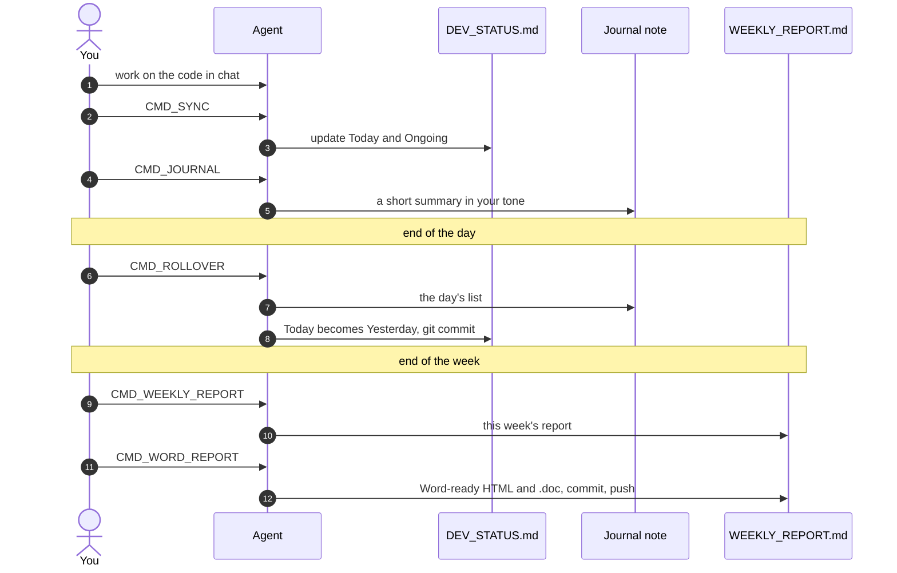
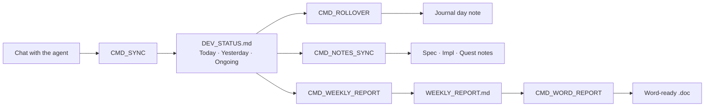
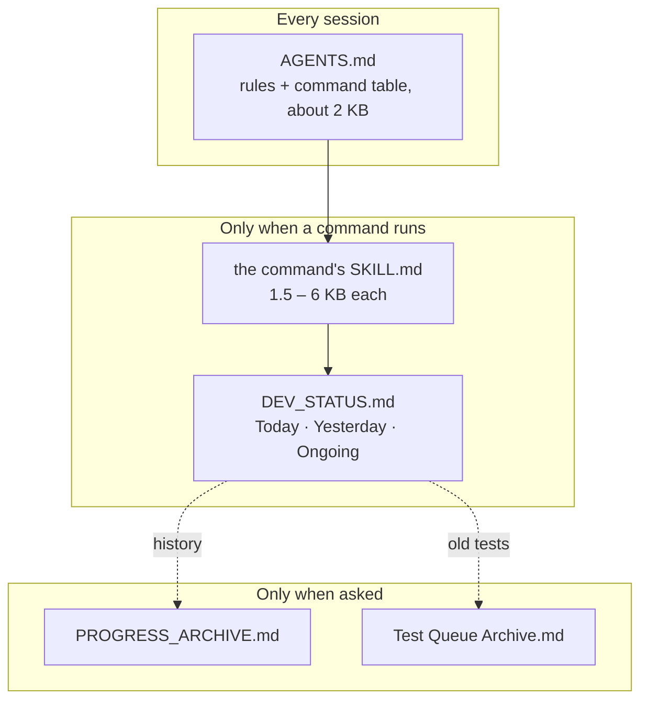
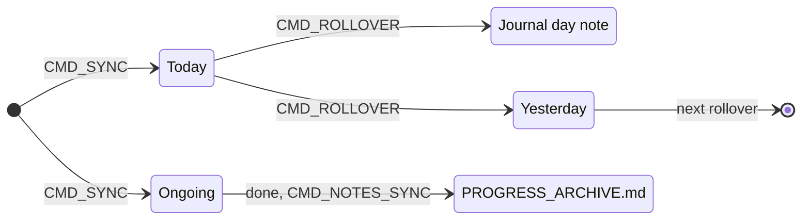
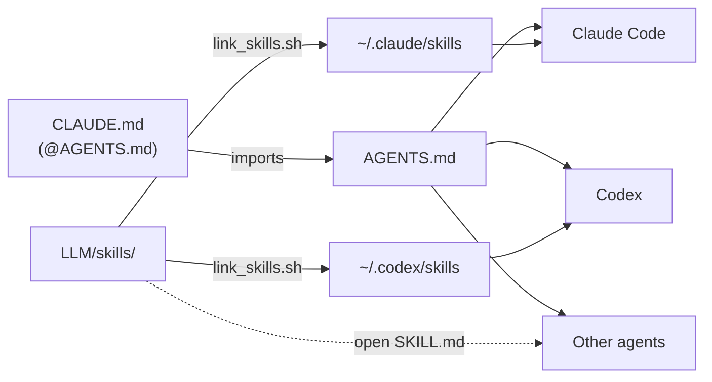
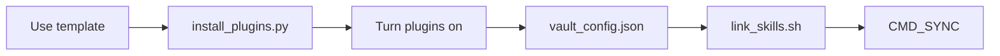
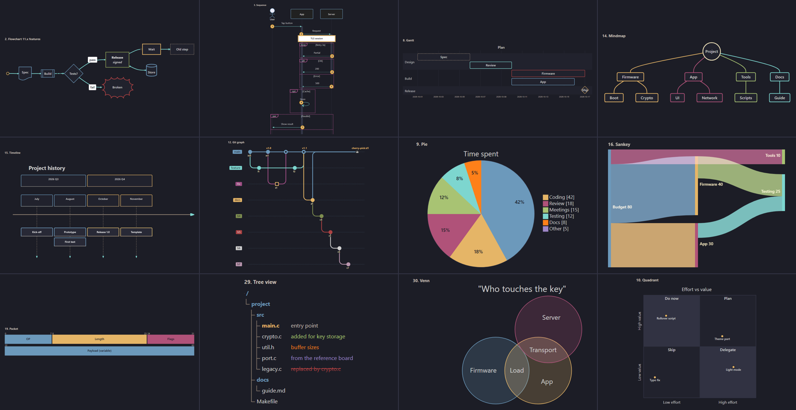

# agent-worklog-vault

**English** · [繁體中文](README.zh-TW.md)

An Obsidian vault that keeps a project's daily work log, notes and reports **together with an LLM coding agent** (Claude Code, Codex, or any agent that reads `AGENTS.md`).

You work with the agent in chat as usual. A few short commands (`CMD_SYNC`, `CMD_ROLLOVER`, …) let it keep the status list, the journal, the notes and the weekly report up to date. Each command is an [Agent Skill](https://agentskills.io) stored in the vault, so the rules are versioned with your notes.

| You get | How |
| :--- | :--- |
| A status list that is always current | `CMD_SYNC` writes what was done today into `LLM/DEV_STATUS.md` |
| A journal without writing it | `CMD_ROLLOVER` moves the day into its journal note; `CMD_JOURNAL` writes the summary in your own tone |
| Notes that match the code | `CMD_NOTES_SYNC` checks notes against the git history and fixes stale facts |
| The weekly report in minutes | `CMD_WEEKLY_REPORT` builds it; `CMD_WORD_REPORT` turns it into a Word-ready file |
| A small agent context | Only the command that runs is loaded; history is read on demand |
| Readable diagrams | A dark theme for every Mermaid diagram type, plus a guide for the agent |

---

## A day with the vault

## How it works

### What the agent reads, and when

The agent only loads what the current task needs. That keeps answers fast and cheap.

### The life of a status item

`DEV_STATUS.md` shows each section as a foldable callout with a count (`3 items`, `25 open`). `Tools/status/counts.py` keeps the counts right, so nobody counts by hand.

### One vault, any agent

`AGENTS.md` is the single source of the instructions; `CLAUDE.md` only imports it. Skills live in the vault and are linked into each agent's skills folder, so one edit changes the command for every agent.

---

## Setup

1. **Copy the vault**: use this repo as a template (or clone it). Do not open it in Obsidian yet.
2. **Plugin code and theme**: run `python3 Tools/setup/install_plugins.py`. It downloads every plugin's code and the **Minimal** theme from their GitHub releases (`--dry-run` only checks the links). The repo keeps each plugin's settings but not its code; without this step the plugins show as installed but fail to turn on.
3. **Plugins**: open the folder in Obsidian, Settings → Community plugins → turn on community plugins, then turn each one on.
4. **Snippets**: Settings → Appearance → CSS snippets: all five are already enabled.
5. **Your values**: edit `LLM/vault_config.json` (`owner`, `coauthor`, `skill_dirs`, `weekly_report`) and fill the Project Information at the top of `LLM/LLM_GUIDE.md`.
6. **Skills**: `bash Tools/skills/link_skills.sh` links every skill into each installed agent's skills folder. Run it again after adding a skill.
7. **Git**: keep this repo or `git init`, then add your own remote. Rollover and the weekly report commit only the files they write.

Needs Python 3.9+ for `Tools/`. Filling the company `.doc` (`weekly_report.py --fill`) needs Windows with Word, reached from WSL.

<b>Plugins and what they are for</b>

| Plugin | Needed for |
| :--- | :--- |
| Templater | **Required.** Day and week notes (`_Meta/Template`, scripts in `_Meta/Scripts`) |
| Minimal Theme Settings | **Required.** Colourful headings and theme options |
| Style Settings | **Required.** Colour controls of the Popping and Locking snippet |
| Calendar | Opening day and week notes from a calendar |
| Breadcrumbs | `up:` links and the folder-note maps |
| Dataview | Tables and lists from note properties |
| Tab Panels | Tabbed notes (styled by `tab-panels-vertical.css`) |
| Mermaid ELK Renderer | `%% elk %%` as the first line of a diagram for ELK layout; with *Use bundled Mermaid* on, every diagram renders with Mermaid 11.17 (fishbone, tree view, venn, …) |
| Hover Editor | Editing in hover popups |
| make.md | Note icons (`sticker:`) and folder notes; it shows the file name as the title, so notes have no `# Title` line |

Without Python: delete a plugin's folder, install it from Settings → Community plugins → Browse, then restore its `data.json` from git.

---

## Commands

| Command | Does |
| :--- | :--- |
| `CMD_SYNC` | Update Today, Yesterday and Ongoing from the chat |
| `CMD_ROLLOVER` | Move Today into its day note and to Yesterday, then commit |
| `CMD_NOTES_SYNC [date]` | Fix notes that disagree with the code, archive finished items |
| `CMD_JOURNAL [date]` | Journal summary in the day note, learning from your edits |
| `CMD_REPORT [date]` | Three-part summary in the week note |
| `CMD_WEEKLY_REPORT` / `CMD_WEEKLY_SYNC` | Rebuild / update `WEEKLY_REPORT.md` |
| `CMD_WORD_REPORT` | Word-ready HTML and the company `.doc`, commit and push |

Three skills work without a command:

- `git-workflow`: branches, `--no-ff` merges and merge requests in your code repos
- `test-queue`: one test checklist per branch, ticked as results come in
- `mermaid-diagrams`: which diagram type to use, how to keep it readable, no hard-coded colours

Journal and report text is written in Traditional Chinese in a Taiwan work-log tone (`LLM/TONE.md`); rules and skills are in English. To change the language, edit `LLM/TONE.md` and the `cmd-journal`, `cmd-report` and `cmd-weekly-report` skills.

---

## Diagrams

`mermaid-afterglow.css` gives every Mermaid type a dark, readable look: dark blocks with coloured borders and light text, white label chips, and one palette for all charts. `_Meta/Mermaid Preview.md` draws all 34 samples live in the vault.

- Mark meaning with built-in classes, no colours in the diagram: `:::pass`, `:::fail`, `:::warn`, `:::info`, `:::muted`.
- Tree views take status classes on the comment: `:::new`, `:::edited`, `:::ported`, `:::removed`.
- After changing a colour, `python3 Tools/mermaid_preview/preview.py render` draws every type with Obsidian's own Mermaid in headless Edge, so you can check it without opening each note.

---

## Customising

| To change | Edit |
| :--- | :--- |
| A command's rules | `LLM/skills/<name>/SKILL.md` (applies to every linked agent at once) |
| Shared rules for the agent | `AGENTS.md` and `LLM/LLM_GUIDE.md` |
| Your name, co-author line, report file names | `LLM/vault_config.json` |
| Colours | Style Settings → Popping and Locking (swatches in `_Meta/Theme Color Preview.md`) |
| Diagram look | `.obsidian/snippets/mermaid-afterglow.css`, then `preview.py render` to check |
| Journal tone | `LLM/TONE.md` (it also learns from your edits) |

---

## Credits

- **[Popping and Locking](https://github.com/hedinne/popping-and-locking-vscode)** by hedinne (MIT): the palette and syntax colours of `popping-and-locking.css` come from this VS Code theme. Licence text: [`licenses/popping-and-locking-vscode.txt`](licenses/popping-and-locking-vscode.txt).
- **[Minimal](https://github.com/kepano/obsidian-minimal)** by kepano (MIT): the theme the snippets are layered on; installed separately, not included.
- **[Mermaid](https://mermaid.js.org)** (MIT): rendered by Obsidian and the Mermaid ELK Renderer plugin; `mermaid-afterglow.css` only restyles its output.
- **Plugins**: this repo keeps only their settings (`data.json`, `manifest.json`); the code is downloaded from each author's release by `Tools/setup/install_plugins.py`.

  | Plugin | Author | Licence |
  | :--- | :--- | :--- |
  | [Templater](https://github.com/silentvoid13/Templater) | SilentVoid13 | AGPL-3.0 |
  | [Minimal Theme Settings](https://github.com/kepano/obsidian-minimal-settings) | kepano | MIT |
  | [Style Settings](https://github.com/obsidian-community/obsidian-style-settings) | mgmeyers / obsidian-community | GPL-3.0 |
  | [Breadcrumbs](https://github.com/michaelpporter/breadcrumbs) | michaelpporter | MIT |
  | [Calendar](https://github.com/liamcain/obsidian-calendar-plugin) | liamcain | MIT |
  | [Dataview](https://github.com/blacksmithgu/obsidian-dataview) | blacksmithgu | MIT |
  | [Tab Panels](https://github.com/gnoxnahte/obsidian-tab-panels) | GnoxNahte | MIT |
  | [Mermaid ELK Renderer](https://github.com/smolblackhole/mermaid-elk-renderer) | SmolBlackHole | MIT |
  | [Hover Editor](https://github.com/nothingislost/obsidian-hover-editor) | nothingislost | MIT |
  | [make.md](https://github.com/make-md/makemd) | make.md | MIT |

## Licence

MIT, see [`LICENSE`](LICENSE). Third-party parts keep their own licences (see Credits).
