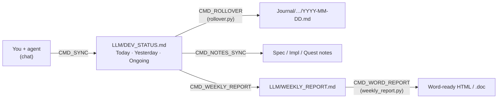

# agent-worklog-vault

An Obsidian vault for keeping a project's daily work log, notes and reports together with an LLM coding agent (Claude Code, Codex, or any agent that reads `AGENTS.md`).

The agent keeps the status list up to date, rolls each day into a journal note, checks notes against the code, and writes the weekly report. You type short commands (`CMD_SYNC`, `CMD_ROLLOVER`, …); each command is an [Agent Skill](https://agentskills.io) in `LLM/skills/`, versioned with the vault.

## How it works

| File | Role |
| :--- | :--- |
| `AGENTS.md` | Agent instructions and the command table (read by every agent; `CLAUDE.md` imports it) |
| `LLM/LLM_GUIDE.md` | Shared rules: read before edit, trust order, note format |
| `LLM/skills/*/SKILL.md` | One skill per command, loaded only when it runs |
| `LLM/DEV_STATUS.md` | Today, Yesterday and Ongoing work in foldable callouts |
| `LLM/PROGRESS_ARCHIVE.md` | Finished work, read only when needed |
| `LLM/TONE.md` | Your writing style for journal and report text, learned from your edits |
| `LLM/vault_config.json` | Your values: name, commit co-author, skill folders, report file names |
| `Quest/Test Queue.md` | Test checklists per branch; finished groups move to the archive |
| `Tools/` | `rollover.py`, `counts.py`, `link_skills.sh`, `weekly_report.py`, `mermaid_preview/preview.py` |
| `_Meta/Mermaid Preview.md` | Every Mermaid diagram type drawn live with the vault theme |

The split keeps the agent's context small: only the command that runs is loaded, and history lives in archives that are read on demand.

## Setup

1. **Copy the vault**: use this repo as a template (or clone it). Do not open it in Obsidian yet.
2. **Plugin code and theme**: `python3 Tools/setup/install_plugins.py` downloads the code of every plugin below and the **Minimal** theme from their GitHub releases (`--dry-run` only checks the links). The repo keeps each plugin's settings but not its code, so without this step the plugins show as installed but fail to turn on.
3. **Plugins**: open the folder in Obsidian, Settings → Community plugins → turn on community plugins, then turn each one on:

   | Plugin | Needed for |
   | :--- | :--- |
   | Templater | **Required.** Day and week notes (`_Meta/Template`, script folder `_Meta/Scripts`) |
   | Minimal Theme Settings | **Required.** Colorful headings and theme options |
   | Style Settings | **Required.** Colour controls of the Popping and Locking snippet |
   | Calendar | Opening day / week notes from a calendar |
   | Breadcrumbs | `up:` links and the folder-note maps |
   | Dataview | Tables and lists from note properties |
   | Tab Panels | Tabbed notes (styled by `tab-panels-vertical.css`) |
   | Mermaid ELK Renderer | `%% elk %%` (first line of a diagram) for ELK layout; with *Use bundled Mermaid* on it renders every diagram with Mermaid 11.17 (newer types such as fishbone, tree view, venn) |
   | Hover Editor | Editing in hover popups |
   | make.md | Note icons (`sticker:`) and folder notes |

   The plugin settings (`data.json`) are already in `.obsidian/plugins/`. Without Python: delete a plugin's folder, install it from Settings → Community plugins → Browse, then copy its `data.json` back from git.
4. **Snippets**: Settings → Appearance → CSS snippets: all five are enabled. `popping-and-locking.css` is a dark colour theme based on the VS Code theme [Popping and Locking](https://github.com/hedinne/popping-and-locking-vscode); change its colours in Style Settings.
5. **Your values**: edit `LLM/vault_config.json` (`owner`, `coauthor`, `skill_dirs`, `weekly_report`) and fill the Project Information at the top of `LLM/LLM_GUIDE.md`.
6. **Skills**: `bash Tools/skills/link_skills.sh` links every skill into each installed agent's skills folder (`~/.claude/skills`, `~/.codex/skills`, … from `skill_dirs`). Run it again after adding a skill.
7. **Git**: `git init` (or keep this repo) and add your own remote. Rollover and the weekly report commit only the files they write.

Python 3.9+ is needed for the `Tools/` scripts. The weekly `.doc` fill (`weekly_report.py --fill`) needs Windows with Word, reached from WSL.

## Commands

| Command | Does |
| :--- | :--- |
| `CMD_SYNC` | Update Today / Yesterday / Ongoing from the chat |
| `CMD_ROLLOVER` | Move Today into its day note and to Yesterday, commit |
| `CMD_NOTES_SYNC [date]` | Fix notes that disagree with the code, archive finished items |
| `CMD_JOURNAL [date]` | Journal bullets in the day note, learn from your edits |
| `CMD_REPORT [date]` | Three-part summary in the week note |
| `CMD_WEEKLY_REPORT` / `CMD_WEEKLY_SYNC` | Rebuild / update `WEEKLY_REPORT.md` |
| `CMD_WORD_REPORT` | Word-ready HTML and the company `.doc`, commit and push |

Three more skills apply without a command: `git-workflow` (branches, merges, merge requests in your code repos), `test-queue` (test checklists) and `mermaid-diagrams` (which diagram type to use and how to keep it readable and themed).

Journal and weekly report text is written in Traditional Chinese in a Taiwan work-log tone (`LLM/TONE.md`); the rules and skills are in English. Change the language in `LLM/TONE.md` and the `cmd-journal` / `cmd-report` / `cmd-weekly-report` skills.

## Customising

- **A command's rules**: edit its `LLM/skills/<name>/SKILL.md`; the change applies to every linked agent at once.
- **Status layout**: `cmd-sync` describes the callouts; `Tools/status/counts.py` keeps their counts.
- **Colours**: Style Settings → Popping and Locking; swatches and the chosen heading colours are in `_Meta/Theme Color Preview.md`.
- **Diagrams**: `mermaid-afterglow.css` themes every Mermaid type (34 samples) from the palette variables only (series colours `--diagram-c1` … `c8`, classes `:::pass` / `:::fail` / `:::warn` / `:::info` / `:::muted`). After changing a colour, `python3 Tools/mermaid_preview/preview.py render` draws every type with Obsidian's own Mermaid in headless Edge (Windows + WSL; paths in `vault_config.json`).

## Credits

- **[Popping and Locking](https://github.com/hedinne/popping-and-locking-vscode)** by hedinne (MIT): the palette and syntax colours of `popping-and-locking.css` come from this VS Code theme. Licence text: [`licenses/popping-and-locking-vscode.txt`](licenses/popping-and-locking-vscode.txt).
- **[Minimal](https://github.com/kepano/obsidian-minimal)** by kepano (MIT): the theme the snippets are layered on; installed separately, not included.
- **[Mermaid](https://mermaid.js.org)** (MIT): rendered by Obsidian and the Mermaid ELK Renderer plugin; `mermaid-afterglow.css` only restyles its output.
- **Plugins**: this repo keeps only their settings (`data.json`, `manifest.json`); the code is downloaded from each author's release by `Tools/setup/install_plugins.py`.

  | Plugin | Author | Licence |
  | :--- | :--- | :--- |
  | [Templater](https://github.com/silentvoid13/Templater) | SilentVoid13 | AGPL-3.0 |
  | [Minimal Theme Settings](https://github.com/kepano/obsidian-minimal-settings) | kepano | MIT |
  | [Style Settings](https://github.com/obsidian-community/obsidian-style-settings) | mgmeyers / obsidian-community | GPL-3.0 |
  | [Breadcrumbs](https://github.com/michaelpporter/breadcrumbs) | michaelpporter | MIT |
  | [Calendar](https://github.com/liamcain/obsidian-calendar-plugin) | liamcain | MIT |
  | [Dataview](https://github.com/blacksmithgu/obsidian-dataview) | blacksmithgu | MIT |
  | [Tab Panels](https://github.com/gnoxnahte/obsidian-tab-panels) | GnoxNahte | MIT |
  | [Mermaid ELK Renderer](https://github.com/smolblackhole/mermaid-elk-renderer) | SmolBlackHole | MIT |
  | [Hover Editor](https://github.com/nothingislost/obsidian-hover-editor) | nothingislost | MIT |
  | [make.md](https://github.com/make-md/makemd) | make.md | MIT |

