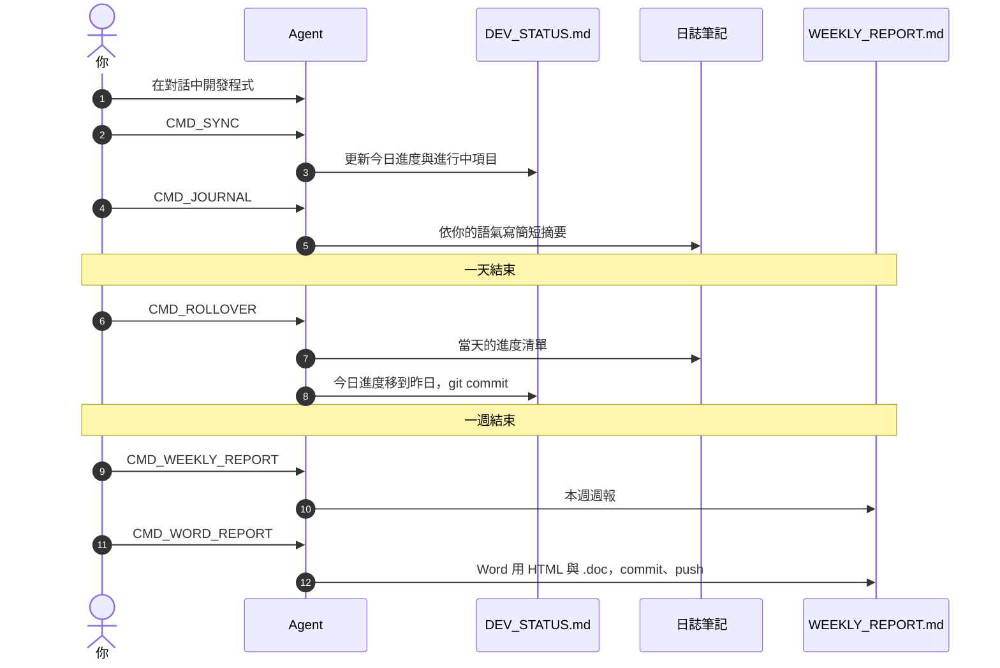
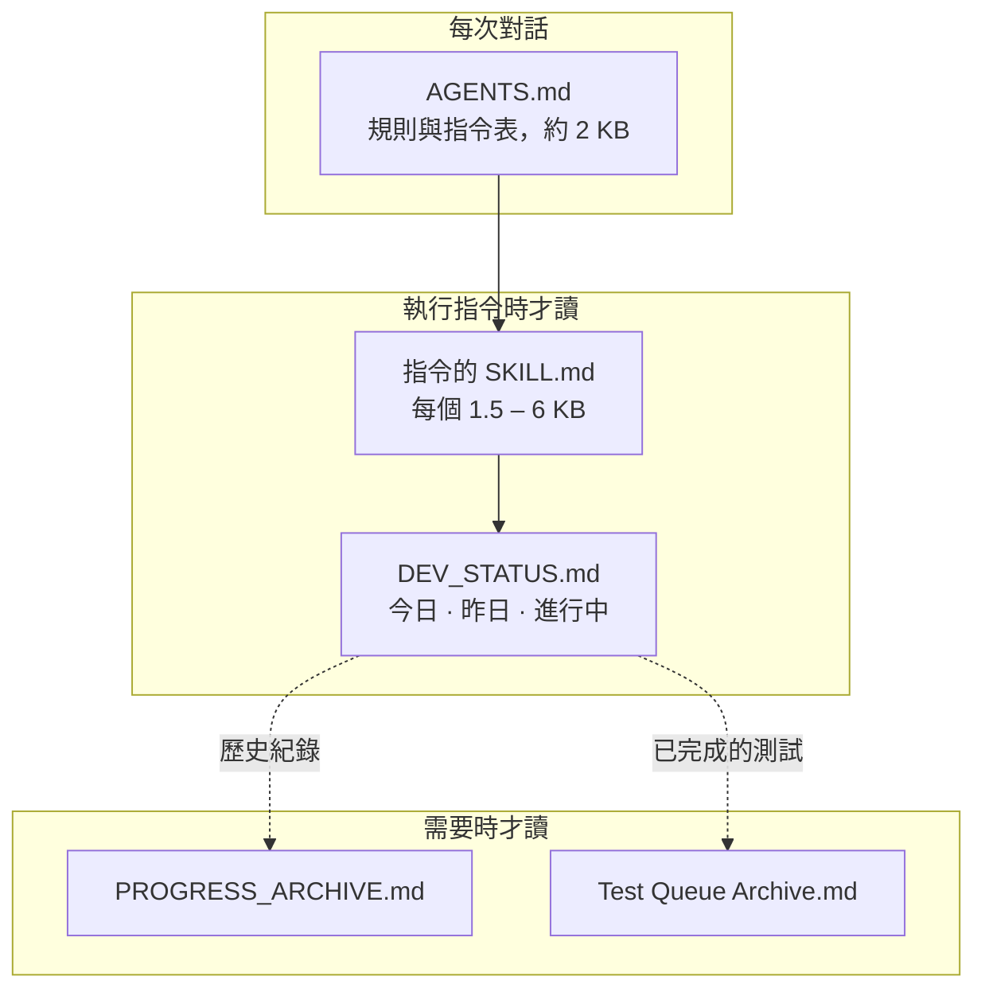
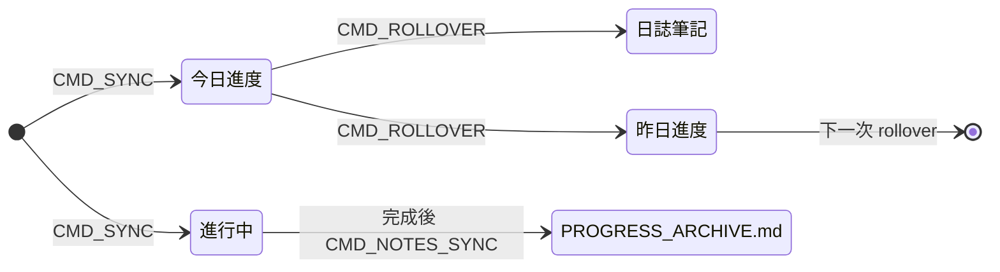
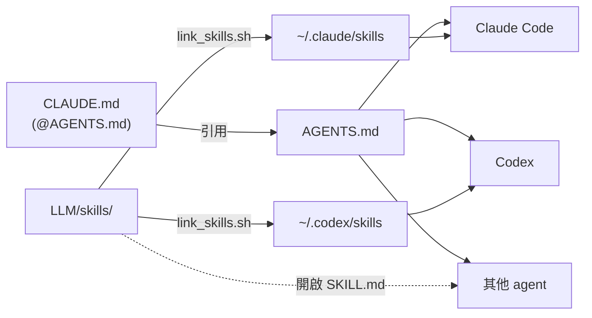
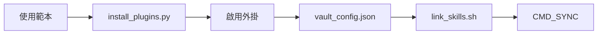

# agent-worklog-vault

[English](README.md) · **繁體中文**

一個 Obsidian 筆記庫，讓專案的每日工作紀錄、筆記與週報**和 LLM 程式開發 agent 一起維護**（Claude Code、Codex，或任何會讀取 `AGENTS.md` 的 agent）。

平常照樣在對話中和 agent 一起開發，再用幾個簡短的指令（`CMD_SYNC`、`CMD_ROLLOVER`…）讓 agent 更新進度清單、日誌、筆記與週報。每個指令都是一個 [Agent Skill](https://agentskills.io)，存放在筆記庫裡，規則和筆記一起用 git 管理版本。

| 得到什麼 | 怎麼做到 |
| :--- | :--- |
| 隨時正確的進度清單 | `CMD_SYNC` 把今天完成的事寫進 `LLM/DEV_STATUS.md` |
| 不用自己寫的日誌 | `CMD_ROLLOVER` 把當天的進度移到日誌筆記；`CMD_JOURNAL` 依你的語氣寫摘要 |
| 與程式碼一致的筆記 | `CMD_NOTES_SYNC` 對照 git 紀錄檢查筆記，修正過時的內容 |
| 幾分鐘完成週報 | `CMD_WEEKLY_REPORT` 產生週報；`CMD_WORD_REPORT` 轉成可貼進 Word 的檔案 |
| 精簡的 agent 上下文 | 只載入正在執行的指令，歷史紀錄需要時才讀 |
| 好讀的圖表 | 每一種 Mermaid 圖都有深色主題，並附給 agent 的繪圖指引 |

---

## 一天的流程

## 運作方式

### Agent 讀什麼、什麼時候讀

Agent 只載入當下工作需要的檔案，回應更快、花費更少。

### 一個進度項目的生命週期

`DEV_STATUS.md` 的每個區塊都是可摺疊的 callout，標題帶有數量（`3 items`、`25 open`），由 `Tools/status/counts.py` 自動更新，不用手動計算。

### 一個筆記庫，任何 agent

`AGENTS.md` 是唯一的指令來源，`CLAUDE.md` 只是引用它。Skill 存放在筆記庫，再連結到各 agent 的 skills 資料夾，所以改一次，所有 agent 的指令都一起更新。

---

## 安裝設定

1. **複製筆記庫**：以這個 repo 為範本建立（或 clone）。先不要用 Obsidian 開啟。
2. **外掛程式碼與主題**：執行 `python3 Tools/setup/install_plugins.py`，從各外掛的 GitHub release 下載程式碼與 **Minimal** 主題（`--dry-run` 只檢查連結）。repo 只保存外掛設定、不含程式碼；少了這一步，外掛會顯示已安裝，但無法啟用。
3. **外掛**：用 Obsidian 開啟資料夾，設定 → 社群外掛 → 開啟社群外掛，再逐一啟用。
4. **CSS 片段**：設定 → 外觀 → CSS 片段：五個片段都已啟用。
5. **個人設定**：編輯 `LLM/vault_config.json`（`owner`、`coauthor`、`skill_dirs`、`weekly_report`），並填寫 `LLM/LLM_GUIDE.md` 開頭的 Project Information。
6. **Skill**：`bash Tools/skills/link_skills.sh` 把每個 skill 連結到已安裝 agent 的 skills 資料夾；新增 skill 後再執行一次。
7. **Git**：沿用這個 repo 或 `git init`，再加上自己的 remote。Rollover 與週報只會 commit 它們寫入的檔案。

`Tools/` 的腳本需要 Python 3.9 以上。填寫公司週報 `.doc`（`weekly_report.py --fill`）需要裝有 Word 的 Windows，並從 WSL 執行。

<b>外掛與用途</b>

| 外掛 | 用途 |
| :--- | :--- |
| Templater | **必要。** 日誌與週筆記（`_Meta/Template`，腳本在 `_Meta/Scripts`） |
| Minimal Theme Settings | **必要。** 彩色標題與主題選項 |
| Style Settings | **必要。** Popping and Locking 片段的顏色設定 |
| Calendar | 從月曆開啟日誌與週筆記 |
| Breadcrumbs | `up:` 連結與資料夾筆記的關係圖 |
| Dataview | 依筆記屬性產生表格與清單 |
| Tab Panels | 分頁式筆記（樣式來自 `tab-panels-vertical.css`） |
| Mermaid ELK Renderer | 圖表第一行寫 `%% elk %%` 即以 ELK 排版；開啟 *Use bundled Mermaid* 後所有圖表改用 Mermaid 11.17 繪製（魚骨圖、樹狀圖、文氏圖…） |
| Hover Editor | 在浮動視窗中編輯 |
| make.md | 筆記圖示（`sticker:`）與資料夾筆記；會以檔名當標題，所以筆記不寫 `# 標題` |

沒有 Python 時：刪除外掛資料夾，從 設定 → 社群外掛 → 瀏覽 重新安裝，再從 git 還原它的 `data.json`。

---

## 指令

| 指令 | 作用 |
| :--- | :--- |
| `CMD_SYNC` | 依對話內容更新今日、昨日與進行中項目 |
| `CMD_ROLLOVER` | 把今日進度移到日誌筆記與昨日，並 commit |
| `CMD_NOTES_SYNC [日期]` | 修正與程式碼不一致的筆記，封存已完成項目 |
| `CMD_JOURNAL [日期]` | 在日誌筆記寫工作摘要，並從你的修改學習語氣 |
| `CMD_REPORT [日期]` | 在週筆記寫三段式摘要 |
| `CMD_WEEKLY_REPORT` / `CMD_WEEKLY_SYNC` | 重建 / 更新 `WEEKLY_REPORT.md` |
| `CMD_WORD_REPORT` | 產生 Word 用 HTML 與公司 `.doc`，commit 並 push |

另有三個不需指令、自動套用的 skill：

- `git-workflow`：程式碼 repo 的分支、`--no-ff` 合併與 merge request 規則
- `test-queue`：每個分支一份測試清單，依測試結果勾選
- `mermaid-diagrams`：選擇圖表類型、保持易讀、不寫死顏色

日誌與週報以繁體中文、台灣工作日誌語氣撰寫（`LLM/TONE.md`）；規則與 skill 為英文。要改用其他語言，請修改 `LLM/TONE.md` 以及 `cmd-journal`、`cmd-report`、`cmd-weekly-report` 這三個 skill。

---

## 圖表

`mermaid-afterglow.css` 讓每一種 Mermaid 圖都有一致、好讀的深色外觀：深色區塊配彩色外框與淺色文字、白底標籤，所有圖表共用同一組配色。`_Meta/Mermaid Preview.md` 在筆記庫中即時繪出全部 34 個範例。

- 用內建 class 表達意義，圖表裡不寫顏色：`:::pass`、`:::fail`、`:::warn`、`:::info`、`:::muted`。
- 樹狀圖的註解可加狀態 class：`:::new`、`:::edited`、`:::ported`、`:::removed`。
- 修改顏色後，執行 `python3 Tools/mermaid_preview/preview.py render`，會用 Obsidian 內建的 Mermaid 在背景的 Edge 繪出每一種圖，不必逐一開啟筆記檢查。

---

## 自訂

| 想修改 | 編輯 |
| :--- | :--- |
| 某個指令的規則 | `LLM/skills/<名稱>/SKILL.md`（所有連結的 agent 同時生效） |
| Agent 共用規則 | `AGENTS.md` 與 `LLM/LLM_GUIDE.md` |
| 姓名、co-author、週報檔名 | `LLM/vault_config.json` |
| 顏色 | Style Settings → Popping and Locking（色票在 `_Meta/Theme Color Preview.md`） |
| 圖表外觀 | `.obsidian/snippets/mermaid-afterglow.css`，改完用 `preview.py render` 檢查 |
| 日誌語氣 | `LLM/TONE.md`（也會從你的修改自動學習） |

---

## 致謝

- **[Popping and Locking](https://github.com/hedinne/popping-and-locking-vscode)**，作者 hedinne（MIT）：`popping-and-locking.css` 的配色與語法顏色取自這個 VS Code 主題。授權全文：[`licenses/popping-and-locking-vscode.txt`](licenses/popping-and-locking-vscode.txt)。
- **[Minimal](https://github.com/kepano/obsidian-minimal)**，作者 kepano（MIT）：CSS 片段所依附的主題；需另外安裝，不包含在 repo 內。
- **[Mermaid](https://mermaid.js.org)**（MIT）：由 Obsidian 與 Mermaid ELK Renderer 外掛繪製；`mermaid-afterglow.css` 只調整其外觀。
- **外掛**：repo 只保存外掛設定（`data.json`、`manifest.json`），程式碼由 `Tools/setup/install_plugins.py` 從各作者的 release 下載。

  | 外掛 | 作者 | 授權 |
  | :--- | :--- | :--- |
  | [Templater](https://github.com/silentvoid13/Templater) | SilentVoid13 | AGPL-3.0 |
  | [Minimal Theme Settings](https://github.com/kepano/obsidian-minimal-settings) | kepano | MIT |
  | [Style Settings](https://github.com/obsidian-community/obsidian-style-settings) | mgmeyers / obsidian-community | GPL-3.0 |
  | [Breadcrumbs](https://github.com/michaelpporter/breadcrumbs) | michaelpporter | MIT |
  | [Calendar](https://github.com/liamcain/obsidian-calendar-plugin) | liamcain | MIT |
  | [Dataview](https://github.com/blacksmithgu/obsidian-dataview) | blacksmithgu | MIT |
  | [Tab Panels](https://github.com/gnoxnahte/obsidian-tab-panels) | GnoxNahte | MIT |
  | [Mermaid ELK Renderer](https://github.com/smolblackhole/mermaid-elk-renderer) | SmolBlackHole | MIT |
  | [Hover Editor](https://github.com/nothingislost/obsidian-hover-editor) | nothingislost | MIT |
  | [make.md](https://github.com/make-md/makemd) | make.md | MIT |

## 授權

MIT，請見 [`LICENSE`](LICENSE)。第三方元件依其各自的授權（見「致謝」）。
