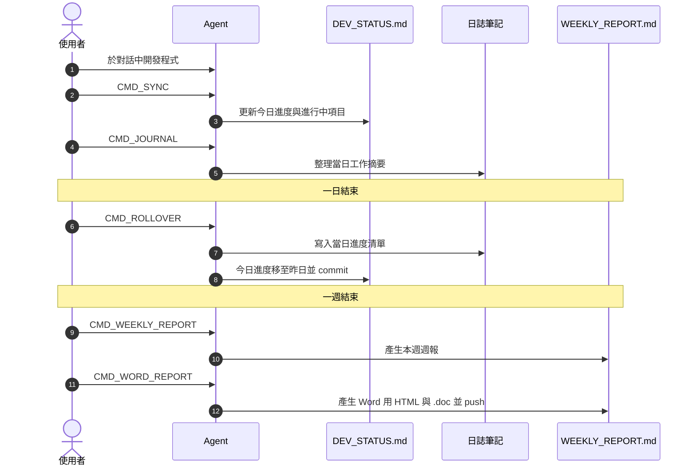
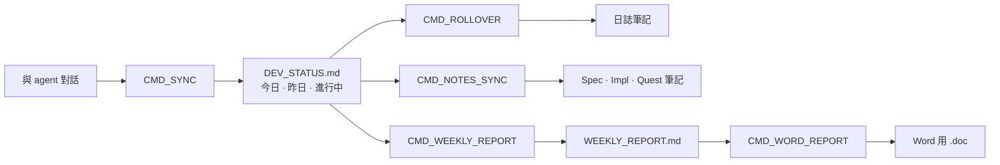
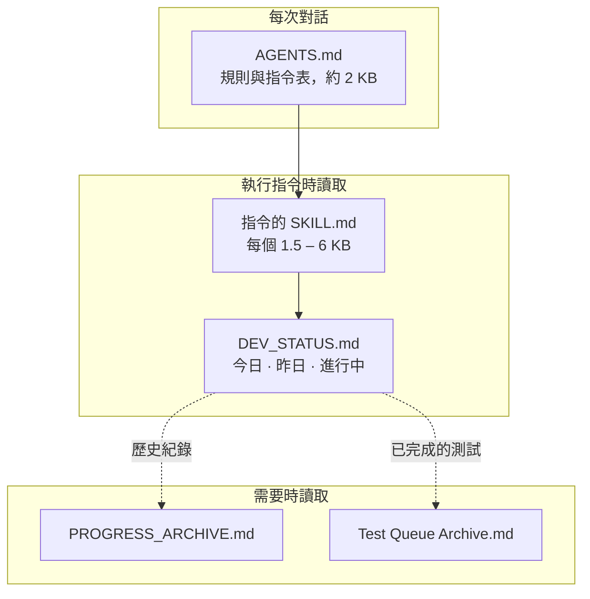
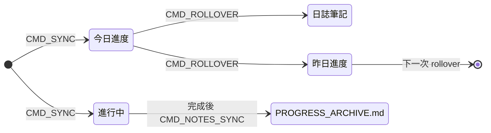
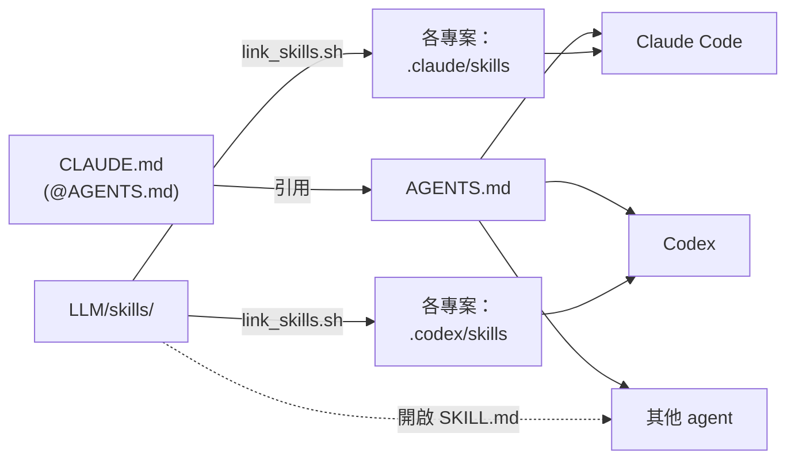
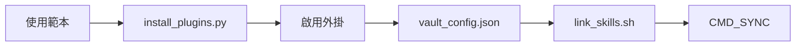
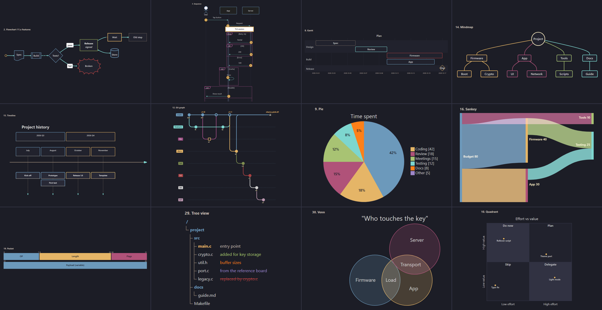

# agent-worklog-vault

[English](README.md) · **繁體中文**

以 Obsidian 筆記庫整合專案的每日工作紀錄、筆記與週報，並透過 **LLM 程式開發 agent** 維護內容（Claude Code、Codex，或其他可讀取 `AGENTS.md` 的 agent）。

開發時於對話中與 agent 協作，再以簡短指令（`CMD_SYNC`、`CMD_ROLLOVER`…）更新進度清單、日誌、筆記與週報。每個指令皆為一個 [Agent Skill](https://agentskills.io)，存放於筆記庫，並與筆記一同以 git 管理版本。

| 功能 | 說明 |
| :--- | :--- |
| 即時更新進度清單 | 透過 `CMD_SYNC` 將當日完成項目寫入 `LLM/DEV_STATUS.md` |
| 自動產生日誌 | 透過 `CMD_ROLLOVER` 將當日進度移至日誌筆記，並以 `CMD_JOURNAL` 依個人語氣整理摘要 |
| 筆記與程式碼一致 | 透過 `CMD_NOTES_SYNC` 對照 git 紀錄檢查筆記，並更新過時內容 |
| 快速產生週報 | 透過 `CMD_WEEKLY_REPORT` 產生週報，再以 `CMD_WORD_REPORT` 轉為 Word 格式 |
| 精簡 agent 上下文 | 僅載入執行中的指令，歷史紀錄於需要時讀取 |
| 易讀的圖表 | 設置所有 Mermaid 圖表類型的深色主題，並提供 agent 繪圖規則 |

---

## 每日流程

## 運作方式

### Agent 讀取檔案的時機

Agent 僅載入當下工作所需的檔案，以便縮短回應時間並降低使用量。

### 進度項目的生命週期

`DEV_STATUS.md` 各區塊皆為可摺疊的 callout，標題顯示項目數量（`3 items`、`25 open`），並由 `Tools/status/counts.py` 自動更新。

### 單一筆記庫支援多種 agent

`AGENTS.md` 為唯一指令來源，`CLAUDE.md` 僅引用此檔案。Skill 存放於筆記庫並連結至各 agent 的 skills 資料夾，修改後所有 agent 同步更新。

### 多專案、多筆記庫

Skill 僅連結至**專案**的 skills 資料夾，不連結至全域資料夾（`~/.claude/skills`）：包含筆記庫本身，以及 `LLM/vault_config.json` 的 `projects` 中由此筆記庫記錄的各程式 repo。因此 `CMD_SYNC` 僅出現於這些專案的 session，且一定寫入此筆記庫；同一台電腦上的其他筆記庫連結至各自的專案，可使用相同的指令名稱。若專案為 git repo，skills 資料夾會加入 `.git/info/exclude`，專案不會產生 commit 或未追蹤檔案。筆記庫若位於專案 repo 內，可直接將 skill commit 至該 repo 的 `.claude/skills/`。

---

## 安裝設定

1. **複製筆記庫**：以此 repo 為範本建立或 clone，完成第 2 步前先不以 Obsidian 開啟。
2. **安裝外掛程式碼與主題**：執行 `python3 Tools/setup/install_plugins.py`，從各外掛的 GitHub release 下載程式碼與 **Minimal** 主題（`--dry-run` 僅檢查連結）。repo 僅保存外掛設定、不含程式碼，未執行此步驟時外掛會顯示已安裝但無法啟用。
3. **啟用外掛**：以 Obsidian 開啟資料夾，於 設定 → 社群外掛 開啟社群外掛後逐一啟用。
4. **確認 CSS 片段**：設定 → 外觀 → CSS 片段，五個片段皆已啟用。
5. **填寫個人設定**：修改 `LLM/vault_config.json`（`owner`、`coauthor`、`projects`、`agents`、`weekly_report`），並填寫 `LLM/LLM_GUIDE.md` 開頭的 Project Information。
6. **連結 Skill**：執行 `bash Tools/skills/link_skills.sh`，依已安裝的 agent，將每個 skill 連結至筆記庫與 `projects` 中各 repo 的專案 skills 資料夾；新增 skill 或專案、或重新 clone 專案後需重新執行。由舊版（連結至 `~/.claude/skills`）升級時，首次執行加上 `--remove-global`。
7. **設置 Git**：沿用此 repo 或執行 `git init`，並新增個人 remote。Rollover 與週報僅 commit 其寫入的檔案。

`Tools/` 腳本需要 Python 3.9 以上；填寫公司週報 `.doc`（`weekly_report.py --fill`）需於裝有 Word 的 Windows 環境並透過 WSL 執行。

<b>外掛與用途</b>

| 外掛 | 用途 |
| :--- | :--- |
| Templater | **必要。** 產生日誌與週筆記（`_Meta/Template`，腳本位於 `_Meta/Scripts`） |
| Minimal Theme Settings | **必要。** 彩色標題與主題選項 |
| Style Settings | **必要。** Popping and Locking 片段的顏色設定 |
| Calendar | 從月曆開啟日誌與週筆記 |
| Breadcrumbs | `up:` 連結與資料夾筆記關係圖 |
| Dataview | 依據筆記屬性產生表格與清單 |
| Tab Panels | 分頁式筆記（樣式由 `tab-panels-vertical.css` 設置） |
| Mermaid ELK Renderer | 圖表第一行加上 `%% elk %%` 即以 ELK 排版；開啟 *Use bundled Mermaid* 後所有圖表改以 Mermaid 11.17 繪製（魚骨圖、樹狀圖、文氏圖…） |
| Hover Editor | 於浮動視窗中編輯 |
| make.md | 筆記圖示（`sticker:`）與資料夾筆記；以檔名作為標題，筆記不需 `# 標題` |

無 Python 環境時：刪除外掛資料夾後，於 設定 → 社群外掛 → 瀏覽 重新安裝，再從 git 還原 `data.json`。

---

## 指令

| 指令 | 作用 |
| :--- | :--- |
| `CMD_SYNC` | 依據對話內容更新今日、昨日與進行中項目 |
| `CMD_ROLLOVER` | 將今日進度移至日誌筆記與昨日，並 commit |
| `CMD_NOTES_SYNC [日期]` | 修正與程式碼不一致的筆記，並封存已完成項目 |
| `CMD_JOURNAL [日期]` | 整理日誌筆記的工作摘要，並依據修改紀錄學習語氣 |
| `CMD_REPORT [日期]` | 整理週筆記的三段式摘要 |
| `CMD_WEEKLY_REPORT` / `CMD_WEEKLY_SYNC` | 重建 / 更新 `WEEKLY_REPORT.md` |
| `CMD_WORD_REPORT` | 產生 Word 用 HTML 與公司 `.doc`，並 commit、push |

以下 skill 不需指令，於相關工作時自動套用：

- `git-workflow`：規範程式碼 repo 的分支、`--no-ff` 合併與 merge request
- `test-queue`：依分支建立測試清單，並依測試結果勾選
- `mermaid-diagrams`：規範圖表類型選擇與易讀性，不寫死顏色

日誌與週報以繁體中文台灣工作日誌語氣撰寫（`LLM/TONE.md`），規則與 skill 為英文。如需改用其他語言，修改 `LLM/TONE.md` 及 `cmd-journal`、`cmd-report`、`cmd-weekly-report` 三個 skill。

---

## 圖表

`mermaid-afterglow.css` 統一所有 Mermaid 圖表類型的深色外觀：深色區塊搭配彩色外框與淺色文字、白底標籤，並共用同一組配色。`_Meta/Mermaid Preview.md` 於筆記庫中即時繪製全部 34 個範例。

- 以內建 class 標示意義，圖表中不寫顏色：`:::pass`、`:::fail`、`:::warn`、`:::info`、`:::muted`。
- 樹狀圖註解可加上狀態 class：`:::new`、`:::edited`、`:::ported`、`:::removed`。
- 修改顏色後執行 `python3 Tools/mermaid_preview/preview.py render`，透過 Obsidian 內建 Mermaid 於背景 Edge 繪製所有圖表類型，以便確認結果而不需逐一開啟筆記。

---

## 自訂

| 修改項目 | 編輯檔案 |
| :--- | :--- |
| 指令規則 | `LLM/skills/<名稱>/SKILL.md`（所有連結的 agent 同時生效） |
| Agent 共用規則 | `AGENTS.md` 與 `LLM/LLM_GUIDE.md` |
| 姓名、co-author、週報檔名 | `LLM/vault_config.json` |
| 顏色 | Style Settings → Popping and Locking（色票位於 `_Meta/Theme Color Preview.md`） |
| 圖表外觀 | `.obsidian/snippets/mermaid-afterglow.css`，修改後以 `preview.py render` 確認 |
| 日誌語氣 | `LLM/TONE.md`（並依據修改紀錄自動學習） |

---

## 第三方元件

- **[Popping and Locking](https://github.com/hedinne/popping-and-locking-vscode)**，作者 hedinne（MIT）：`popping-and-locking.css` 的配色與語法顏色取自此 VS Code 主題。授權全文：[`licenses/popping-and-locking-vscode.txt`](licenses/popping-and-locking-vscode.txt)。
- **[Minimal](https://github.com/kepano/obsidian-minimal)**，作者 kepano（MIT）：CSS 片段所依附的主題，需另外安裝，不包含於 repo 內。
- **[Mermaid](https://mermaid.js.org)**（MIT）：由 Obsidian 與 Mermaid ELK Renderer 外掛繪製，`mermaid-afterglow.css` 僅調整其外觀。
- **外掛**：repo 僅保存外掛設定（`data.json`、`manifest.json`），程式碼由 `Tools/setup/install_plugins.py` 從各作者的 release 下載。

  | 外掛 | 作者 | 授權 |
  | :--- | :--- | :--- |
  | [Templater](https://github.com/silentvoid13/Templater) | SilentVoid13 | AGPL-3.0 |
  | [Minimal Theme Settings](https://github.com/kepano/obsidian-minimal-settings) | kepano | MIT |
  | [Style Settings](https://github.com/obsidian-community/obsidian-style-settings) | mgmeyers / obsidian-community | GPL-3.0 |
  | [Breadcrumbs](https://github.com/michaelpporter/breadcrumbs) | michaelpporter | MIT |
  | [Calendar](https://github.com/liamcain/obsidian-calendar-plugin) | liamcain | MIT |
  | [Dataview](https://github.com/blacksmithgu/obsidian-dataview) | blacksmithgu | MIT |
  | [Tab Panels](https://github.com/gnoxnahte/obsidian-tab-panels) | GnoxNahte | MIT |
  | [Mermaid ELK Renderer](https://github.com/smolblackhole/mermaid-elk-renderer) | SmolBlackHole | MIT |
  | [Hover Editor](https://github.com/nothingislost/obsidian-hover-editor) | nothingislost | MIT |
  | [make.md](https://github.com/make-md/makemd) | make.md | MIT |

## 授權

MIT，詳見 [`LICENSE`](LICENSE)。第三方元件依各自授權（見「第三方元件」）。
