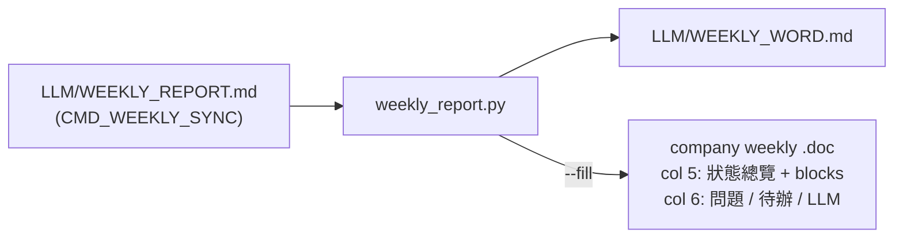

# weekly_report · WEEKLY_REPORT → Word

`weekly_report.py` turns `LLM/WEEKLY_REPORT.md` into Word-safe HTML (`LLM/WEEKLY_WORD.md`) and can fill the company weekly report `.doc` directly through Word.



## Run (WSL)

```bash
cd Tools/weekly_report
python3 weekly_report.py                  # WEEKLY_WORD.md only
python3 weekly_report.py --fill --pdf     # + fill this week's .doc, PDF preview
python3 weekly_report.py --fill --force   # replace content already in the .doc
```

| Option | Effect |
|---|---|
| *(none)* | Rebuild `WEEKLY_WORD.md` |
| `--fill` | Fill the `.doc` for the report week |
| `--force` | Replace content already in the `.doc` (otherwise it refuses) |
| `--pdf` | Export `%TEMP%\weekly_report\weekly_preview.pdf` |

## Week number

Taken from the `> 週期：YYYY-MM-DD ~ ... (Week NN)` line, so run `CMD_WEEKLY_SYNC` (week roll) first.

- Target: `doc_dir` / `doc_name` in `LLM/vault_config.json`
- Missing → copied from the blank template `template_glob` in `LLM/vault_config.json`
- Header `YYYY第NN週` in the first line is rewritten

> [!warning] Close the `.doc` in Word first
> An open file is locked; the script stops with a message. If a hidden Word hangs (e.g. on a recovery prompt), the script stops it after 120 s; only window-less Word started by the run is touched.

## Layout rules

Palette, board, divider and Word-safe HTML rules live in `LLM/skills/cmd-word-report/word-html-rules.md`. Change the constants at the top of the script together with the guide.
