Every Mermaid diagram type the vault renders, drawn live with the vault theme. Colours come from `mermaid-afterglow.css`, which uses only the variables of `popping-and-locking.css` (Style Settings → Popping and Locking → Diagram Colors). How to choose and write a diagram: skill `mermaid-diagrams`. Colour swatches: [[Theme Color Preview]]. Generated by `Tools/mermaid_preview/preview.py note`.

> [!info] Version
> Diagrams render with **Mermaid 11.17**, bundled by the Mermaid ELK Renderer plugin (setting *Use bundled Mermaid* on; it replaces Obsidian's own 11.13). The 11.12+ types (ishikawa, tree view, venn, railroad, wardley, event modeling, cynefin) and collapsible subgraphs need that setting. Not yet available: the v12 defaults (`neo` look, ELK by default). [Syntax docs](https://mermaid.ai/open-source/syntax/flowchart.html).

> [!tip] ELK layout
> A first line `%% elk %%` makes the plugin lay the diagram out with ELK: fewer crossings and straighter edges for flowcharts with subgraphs and for state machines (samples 24 – 27 compare). It is not better for every type: check the class sample. Other ELK algorithms (`elk.mrtree`, `elk.force`, `elk.stress`) are chosen in front matter: `config:` / `layout: elk.mrtree`.

## Colours

> [!abstract] Diagram colours
> - **Nodes**: fill `--background-primary-alt`, border `--diagram-node-border`, text `--diagram-text`; edges `--diagram-edge-color`; groups `--diagram-subgraph-border` (dashed).
> - **Notes and edge labels**: light chip `--diagram-note-bg` with `--diagram-note-text`, border `--diagram-note-border`.
> - **Semantic classes** (no `classDef` needed): `:::pass` `--diagram-success`, `:::fail` `--diagram-error`, `:::warn` `--diagram-warn`, `:::info` `--diagram-info`, `:::muted` faint dashed.
> - **Series** (pie slices, chart bars and lines, gantt / journey / timeline / mindmap sections, radar curves, sankey nodes), in this order:
>
> <span style="display:inline-block;margin:2px 10px 2px 0;font-family:monospace;font-size:12px;"><span style="display:inline-block;width:14px;height:14px;border-radius:3px;background:#6C99BB;vertical-align:middle;margin-right:4px;"></span>--diagram-c1 #6C99BB blue</span><span style="display:inline-block;margin:2px 10px 2px 0;font-family:monospace;font-size:12px;"><span style="display:inline-block;width:14px;height:14px;border-radius:3px;background:#E5B567;vertical-align:middle;margin-right:4px;"></span>--diagram-c2 #E5B567 yellow</span><span style="display:inline-block;margin:2px 10px 2px 0;font-family:monospace;font-size:12px;"><span style="display:inline-block;width:14px;height:14px;border-radius:3px;background:#B05279;vertical-align:middle;margin-right:4px;"></span>--diagram-c3 #B05279 magenta</span><span style="display:inline-block;margin:2px 10px 2px 0;font-family:monospace;font-size:12px;"><span style="display:inline-block;width:14px;height:14px;border-radius:3px;background:#A8C373;vertical-align:middle;margin-right:4px;"></span>--diagram-c4 #A8C373 green</span><span style="display:inline-block;margin:2px 10px 2px 0;font-family:monospace;font-size:12px;"><span style="display:inline-block;width:14px;height:14px;border-radius:3px;background:#7DD6CF;vertical-align:middle;margin-right:4px;"></span>--diagram-c5 #7DD6CF cyan</span><span style="display:inline-block;margin:2px 10px 2px 0;font-family:monospace;font-size:12px;"><span style="display:inline-block;width:14px;height:14px;border-radius:3px;background:#FE8019;vertical-align:middle;margin-right:4px;"></span>--diagram-c6 #FE8019 orange</span><span style="display:inline-block;margin:2px 10px 2px 0;font-family:monospace;font-size:12px;"><span style="display:inline-block;width:14px;height:14px;border-radius:3px;background:#9E86C8;vertical-align:middle;margin-right:4px;"></span>--diagram-c7 #9E86C8 purple</span><span style="display:inline-block;margin:2px 10px 2px 0;font-family:monospace;font-size:12px;"><span style="display:inline-block;width:14px;height:14px;border-radius:3px;background:#D3869B;vertical-align:middle;margin-right:4px;"></span>--diagram-c8 #D3869B pink</span>

## 1. Flowchart

*shapes, edge kinds, edge labels, subgraph, pass / fail classes* · [syntax](https://mermaid.ai/open-source/syntax/flowchart.html)

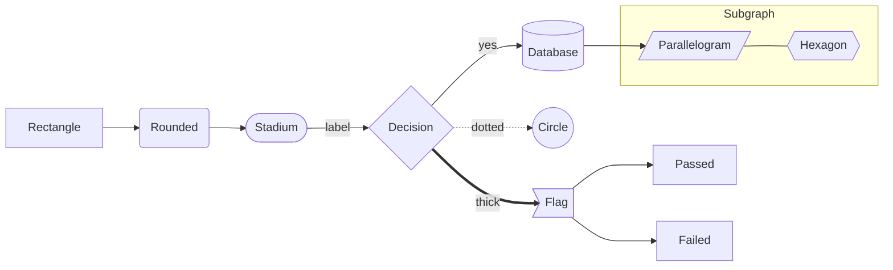

> [!example]- Source
> ```text
> flowchart LR
>     A[Rectangle] --> B(Rounded) --> C([Stadium])
>     C -->|label| D{Decision}
>     D -- yes --> E[(Database)]
>     D -. dotted .-> F((Circle))
>     D == thick ==> G>Flag]
>     subgraph SG [Subgraph]
>         H[/Parallelogram/] --- I{{Hexagon}}
>     end
>     E --> H
>     G --> P[Passed]:::pass
>     G --> X[Failed]:::fail
> ```

## 2. Flowchart 11.x features

*expanded shapes (A@{ shape }), markdown labels, edge ends, animated edge, semantic classes* · [syntax](https://mermaid.ai/open-source/syntax/flowchart.html)

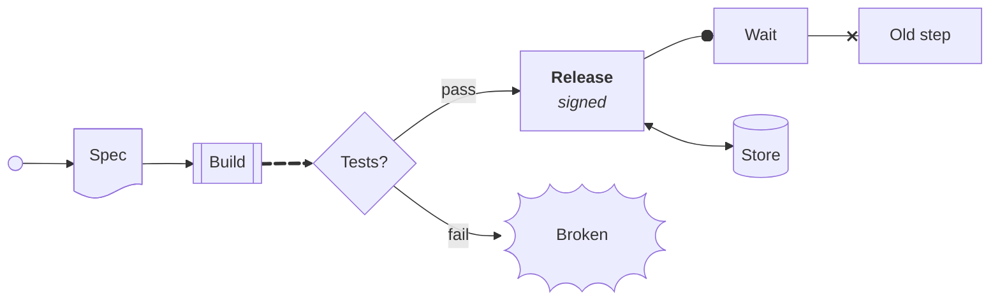

> [!example]- Source
> ```text
> flowchart LR
>     S@{ shape: sm-circ, label: "start" } --> D1@{ shape: doc, label: "Spec" }
>     D1 --> P@{ shape: subproc, label: "Build" }
>     P e1@==> T@{ shape: diam, label: "Tests?" }
>     e1@{ animate: true }
>     T -->|pass| OK["`**Release**
>     _signed_`"]:::pass
>     T -->|fail| BAD@{ shape: bang, label: "Broken" }
>     BAD:::fail
>     OK --o W[Wait]:::warn
>     W --x M[Old step]:::muted
>     OK <--> I@{ shape: cyl, label: "Store" }
>     I:::info
> ```

## 3. Sequence

*actor kinds, sync / async / reply messages, notes, loop / alt / opt / par / critical / rect, activation, autonumber* · [syntax](https://mermaid.ai/open-source/syntax/sequenceDiagram.html)

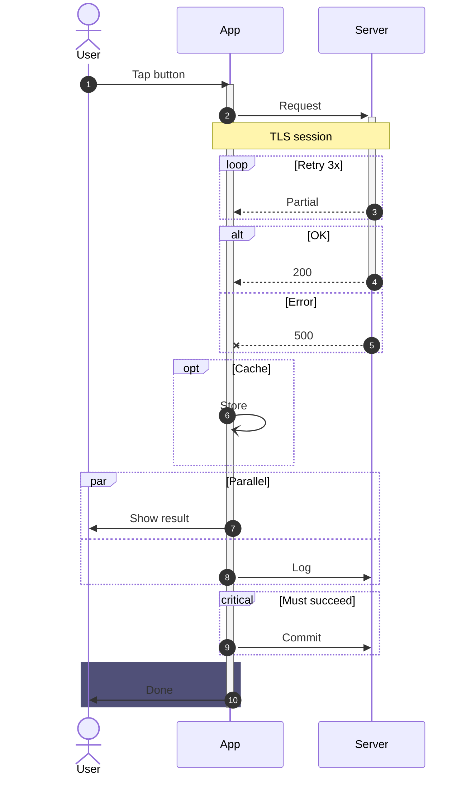

> [!example]- Source
> ```text
> sequenceDiagram
>     autonumber
>     actor U as User
>     participant A as App
>     participant S as Server
>     U->>A: Tap button
>     activate A
>     A->>+S: Request
>     Note over A,S: TLS session
>     loop Retry 3x
>         S-->>A: Partial
>     end
>     alt OK
>         S-->>-A: 200
>     else Error
>         S--xA: 500
>     end
>     opt Cache
>         A-)A: Store
>     end
>     par Parallel
>         A->>U: Show result
>     and
>         A->>S: Log
>     end
>     critical Must succeed
>         A->>S: Commit
>     end
>     rect rgb(80, 80, 120)
>         A->>U: Done
>     end
>     deactivate A
> ```

## 4. Class

*classes, members, relations, cardinality, note* · [syntax](https://mermaid.ai/open-source/syntax/classDiagram.html)

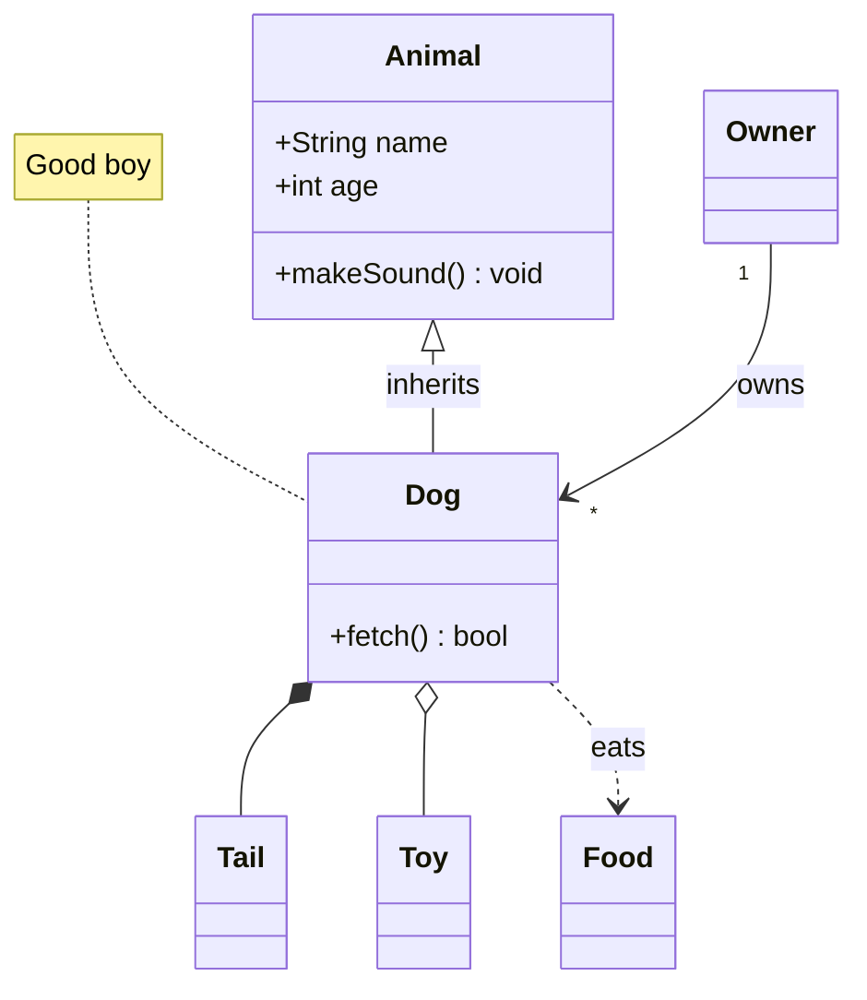

> [!example]- Source
> ```text
> classDiagram
>     class Animal {
>         +String name
>         +int age
>         +makeSound() void
>     }
>     class Dog {
>         +fetch() bool
>     }
>     class Owner
>     Animal <|-- Dog : inherits
>     Owner "1" --> "*" Dog : owns
>     Dog *-- Tail
>     Dog o-- Toy
>     Dog ..> Food : eats
>     note for Dog "Good boy"
> ```

## 5. State

*start / end, composite state, choice, fork / join, note* · [syntax](https://mermaid.ai/open-source/syntax/stateDiagram.html)

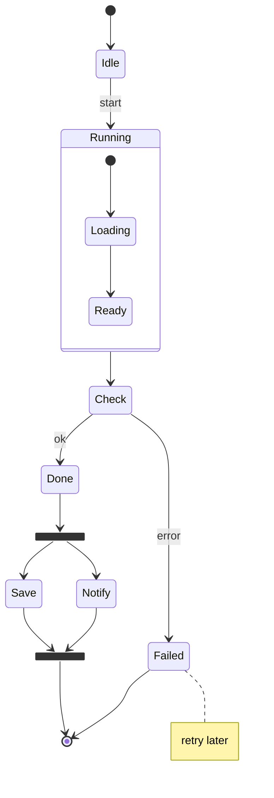

> [!example]- Source
> ```text
> stateDiagram-v2
>     [*] --> Idle
>     Idle --> Running : start
>     state Running {
>         [*] --> Loading
>         Loading --> Ready
>     }
>     Running --> Check
>     state Check <<choice>>
>     Check --> Done : ok
>     Check --> Failed : error
>     state fork_state <<fork>>
>     Done --> fork_state
>     fork_state --> Save
>     fork_state --> Notify
>     state join_state <<join>>
>     Save --> join_state
>     Notify --> join_state
>     join_state --> [*]
>     note right of Failed : retry later
>     Failed --> [*]
> ```

## 6. Entity relationship

*entities, attributes with keys, relation cardinality* · [syntax](https://mermaid.ai/open-source/syntax/entityRelationshipDiagram.html)

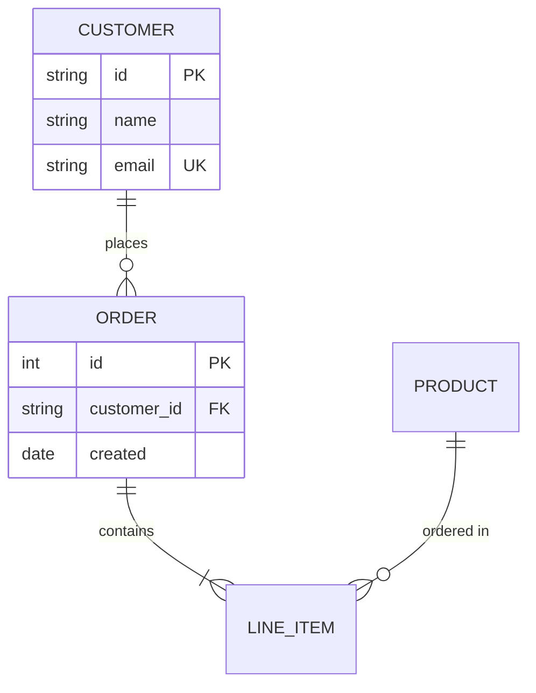

> [!example]- Source
> ```text
> erDiagram
>     CUSTOMER ||--o{ ORDER : places
>     ORDER ||--|{ LINE_ITEM : contains
>     PRODUCT ||--o{ LINE_ITEM : "ordered in"
>     CUSTOMER {
>         string id PK
>         string name
>         string email UK
>     }
>     ORDER {
>         int id PK
>         string customer_id FK
>         date created
>     }
> ```

## 7. User journey

*sections, tasks, scores (faces), actors* · [syntax](https://mermaid.ai/open-source/syntax/userJourney.html)

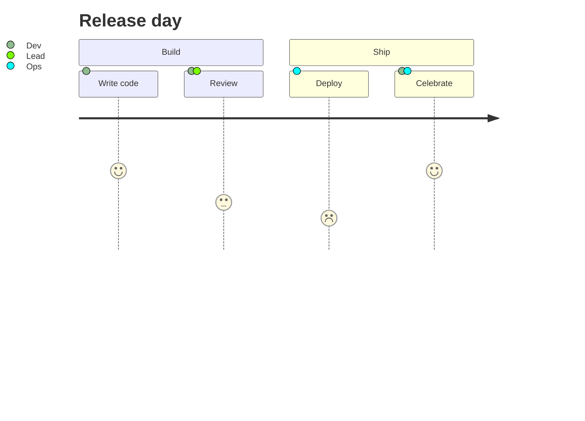

> [!example]- Source
> ```text
> journey
>     title Release day
>     section Build
>         Write code: 5: Dev
>         Review: 3: Dev, Lead
>     section Ship
>         Deploy: 2: Ops
>         Celebrate: 5: Dev, Ops
> ```

## 8. Gantt

*sections, done / active / critical tasks, milestone; config block for taller bars and larger text* · [syntax](https://mermaid.ai/open-source/syntax/gantt.html)

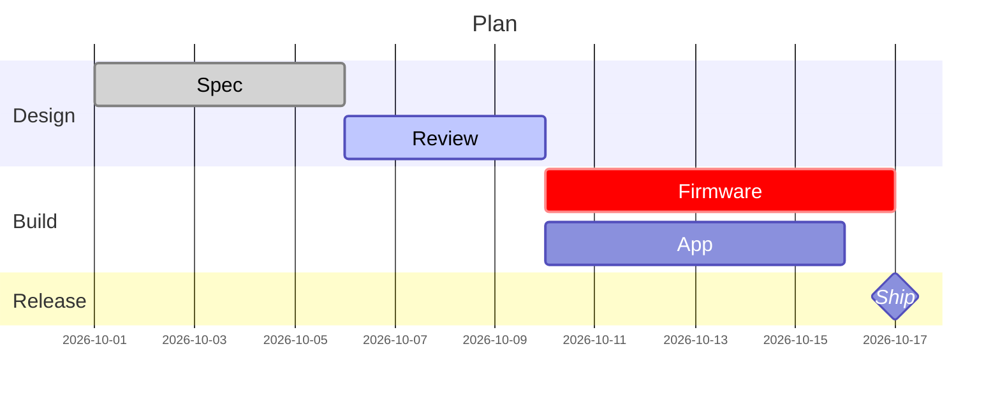

> [!example]- Source
> ```text
> ---
> config:
>   gantt:
>     barHeight: 34
>     barGap: 8
>     fontSize: 16
>     sectionFontSize: 16
> ---
> gantt
>     title Plan
>     dateFormat YYYY-MM-DD
>     section Design
>         Spec          :done, d1, 2026-10-01, 5d
>         Review        :active, d2, after d1, 4d
>     section Build
>         Firmware      :crit, b1, after d2, 7d
>         App           :b2, after d2, 6d
>     section Release
>         Ship          :milestone, m1, after b1, 0d
> ```

## 9. Pie

*slices, legend, title, values* · [syntax](https://mermaid.ai/open-source/syntax/pie.html)

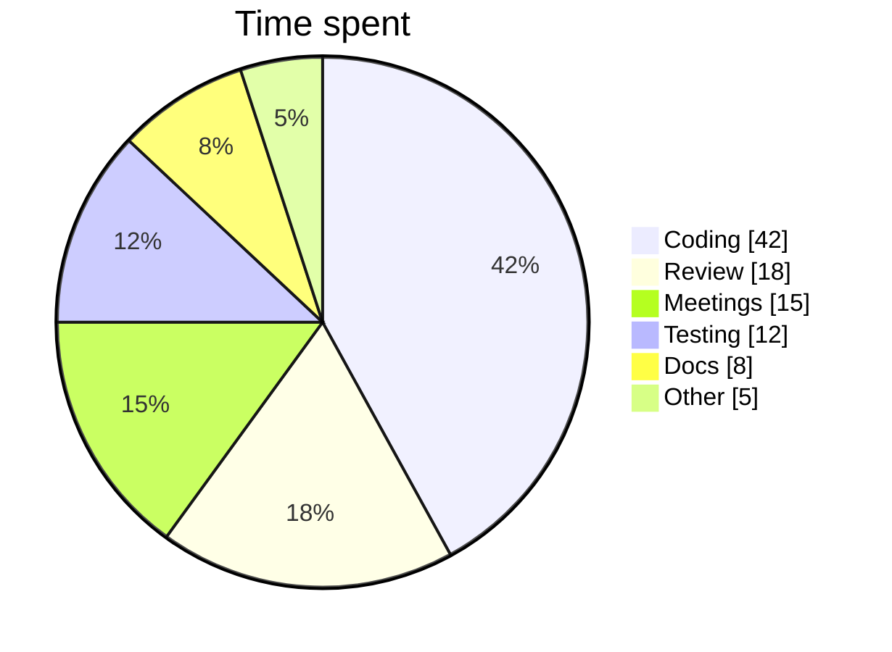

> [!example]- Source
> ```text
> pie showData
>     title Time spent
>     "Coding" : 42
>     "Review" : 18
>     "Meetings" : 15
>     "Testing" : 12
>     "Docs" : 8
>     "Other" : 5
> ```

## 10. Quadrant

*axes, quadrant fills, points* · [syntax](https://mermaid.ai/open-source/syntax/quadrantChart.html)

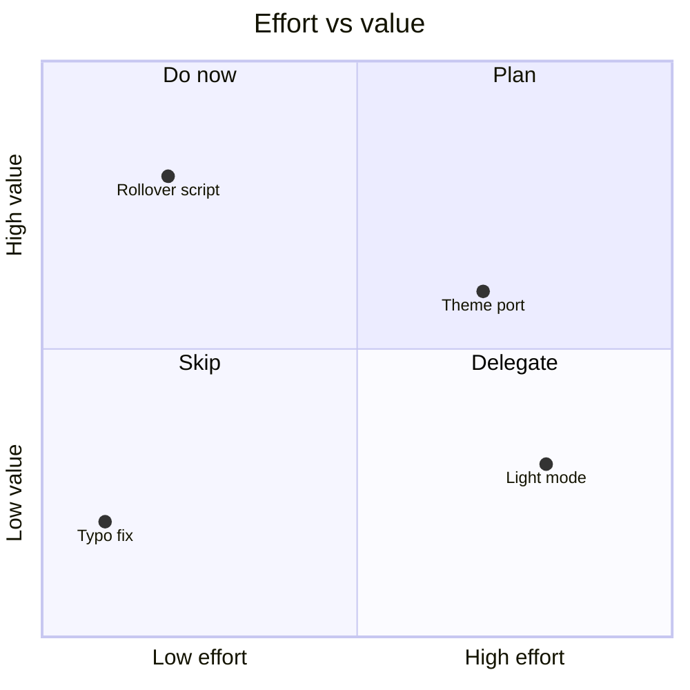

> [!example]- Source
> ```text
> quadrantChart
>     title Effort vs value
>     x-axis Low effort --> High effort
>     y-axis Low value --> High value
>     quadrant-1 Plan
>     quadrant-2 Do now
>     quadrant-3 Skip
>     quadrant-4 Delegate
>     Rollover script: [0.2, 0.8]
>     Theme port: [0.7, 0.6]
>     Light mode: [0.8, 0.3]
>     Typo fix: [0.1, 0.2]
> ```

## 11. Requirement

*requirements, element, relations* · [syntax](https://mermaid.ai/open-source/syntax/requirementDiagram.html)

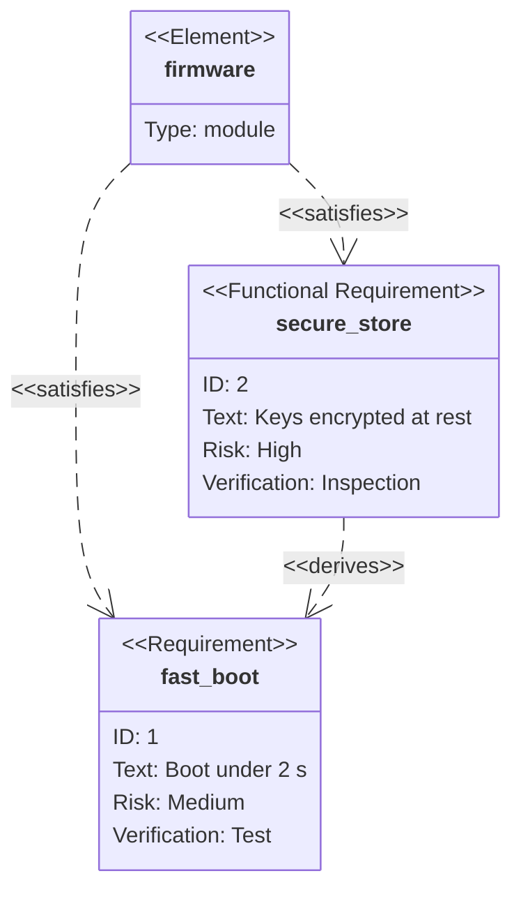

> [!example]- Source
> ```text
> requirementDiagram
>     requirement fast_boot {
>         id: 1
>         text: Boot under 2 s
>         risk: medium
>         verifymethod: test
>     }
>     functionalRequirement secure_store {
>         id: 2
>         text: Keys encrypted at rest
>         risk: high
>         verifymethod: inspection
>     }
>     element firmware {
>         type: module
>     }
>     firmware - satisfies -> fast_boot
>     firmware - satisfies -> secure_store
>     secure_store - derives -> fast_boot
> ```

## 12. Git graph

*branches (8 lane colours), merge, cherry-pick, tags, highlight / reverse commits* · [syntax](https://mermaid.ai/open-source/syntax/gitgraph.html)

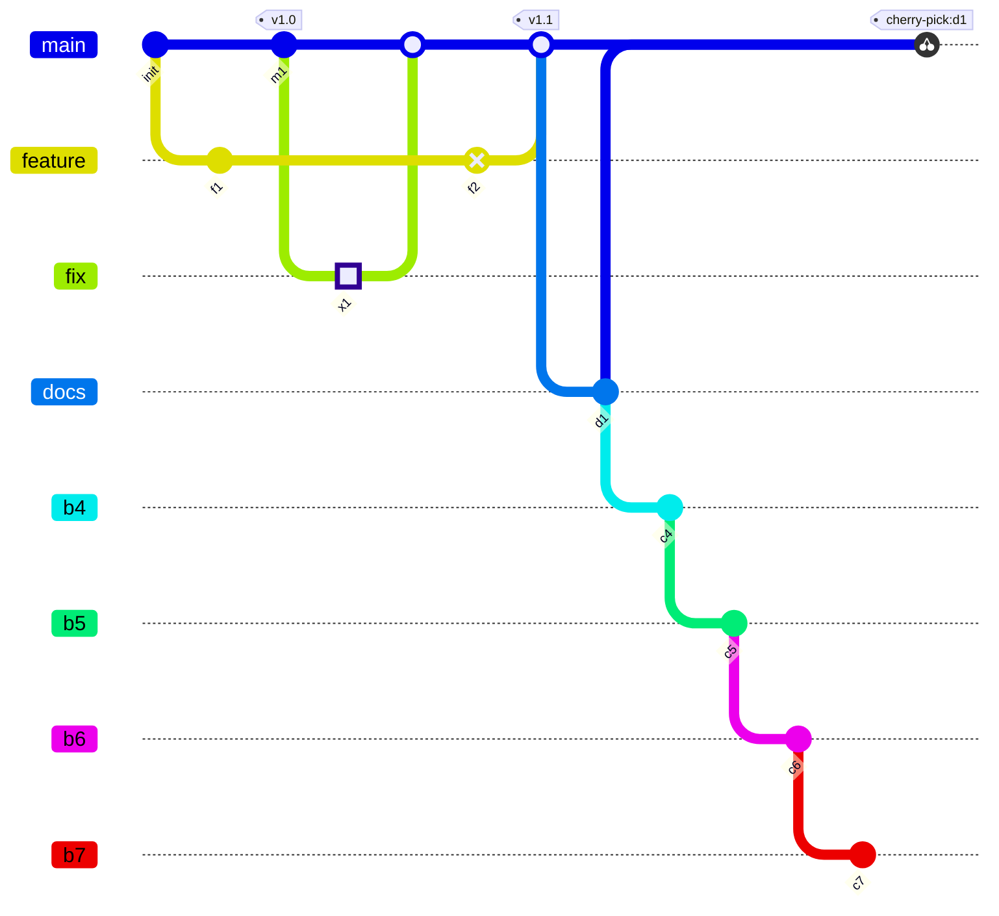

> [!example]- Source
> ```text
> gitGraph
>     commit id: "init"
>     branch feature
>     commit id: "f1"
>     checkout main
>     commit id: "m1" tag: "v1.0"
>     branch fix
>     commit id: "x1" type: HIGHLIGHT
>     checkout main
>     merge fix
>     checkout feature
>     commit id: "f2" type: REVERSE
>     checkout main
>     merge feature tag: "v1.1"
>     branch docs
>     commit id: "d1"
>     branch b4
>     commit id: "c4"
>     branch b5
>     commit id: "c5"
>     branch b6
>     commit id: "c6"
>     branch b7
>     commit id: "c7"
>     checkout main
>     cherry-pick id: "d1"
> ```

## 13. C4 context

*person, system, external system, boundary, relations* · [syntax](https://mermaid.ai/open-source/syntax/c4.html)

```mermaid
C4Context
    title System context
    Person(user, "User", "Uses the app")
    System_Onlineary(b, "Product") {
        System(app, "App", "Mobile app")
        SystemDb(db, "Database", "Stores data")
    }
    System_Ext(pay, "Payment", "External provider")
    Rel(user, app, "Uses")
    Rel(app, db, "Reads / writes")
    Rel(app, pay, "Charges", "HTTPS")
```

> [!example]- Source
> ```text
> C4Context
>     title System context
>     Person(user, "User", "Uses the app")
>     System_Onlineary(b, "Product") {
>         System(app, "App", "Mobile app")
>         SystemDb(db, "Database", "Stores data")
>     }
>     System_Ext(pay, "Payment", "External provider")
>     Rel(user, app, "Uses")
>     Rel(app, db, "Reads / writes")
>     Rel(app, pay, "Charges", "HTTPS")
> ```

## 14. Mindmap

*root and section colours by level* · [syntax](https://mermaid.ai/open-source/syntax/mindmap.html)

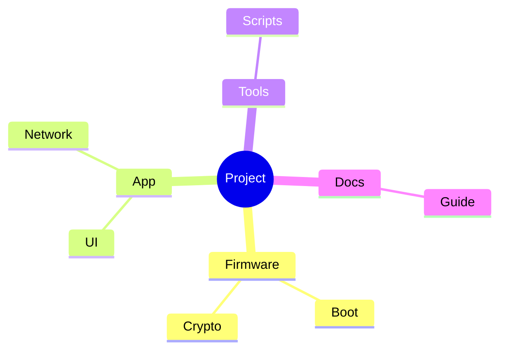

> [!example]- Source
> ```text
> mindmap
>     root((Project))
>         Firmware
>             Boot
>             Crypto
>         App
>             UI
>             Network
>         Tools
>             Scripts
>         Docs
>             Guide
> ```

## 15. Timeline

*periods, events, section colours* · [syntax](https://mermaid.ai/open-source/syntax/timeline.html)

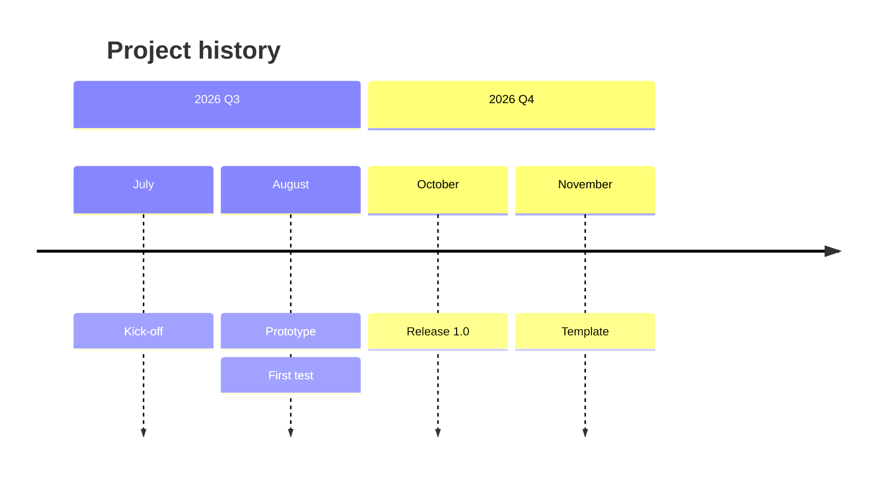

> [!example]- Source
> ```text
> timeline
>     title Project history
>     section 2026 Q3
>         July : Kick-off
>         August : Prototype : First test
>     section 2026 Q4
>         October : Release 1.0
>         November : Template
> ```

## 16. Sankey

*nodes and weighted flows* · [syntax](https://mermaid.ai/open-source/syntax/sankey.html)

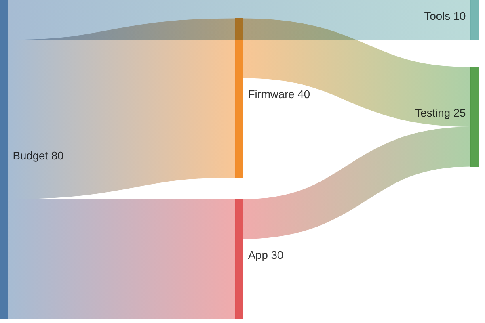

> [!example]- Source
> ```text
> sankey-beta
> Budget,Firmware,40
> Budget,App,30
> Budget,Tools,10
> Firmware,Testing,15
> App,Testing,10
> ```

## 17. XY chart

*bar and line series, axes, title* · [syntax](https://mermaid.ai/open-source/syntax/xyChart.html)

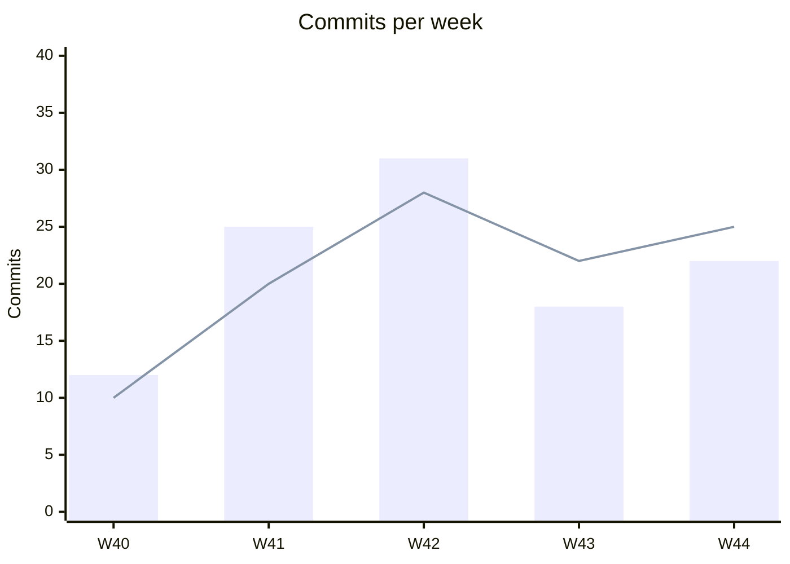

> [!example]- Source
> ```text
> xychart-beta
>     title "Commits per week"
>     x-axis [W40, W41, W42, W43, W44]
>     y-axis "Commits" 0 --> 40
>     bar [12, 25, 31, 18, 22]
>     line [10, 20, 28, 22, 25]
> ```

## 18. Block

*columns, blocks, shapes, arrows* · [syntax](https://mermaid.ai/open-source/syntax/block.html)

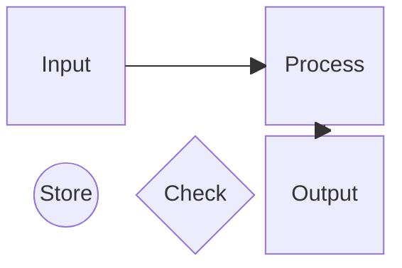

> [!example]- Source
> ```text
> block-beta
>     columns 3
>     a["Input"] space b["Process"]
>     a --> b
>     c(("Store")) d{"Check"} e["Output"]
>     b --> e
> ```

## 19. Packet

*bit fields of a frame; config block for taller rows* · [syntax](https://mermaid.ai/open-source/syntax/packet.html)

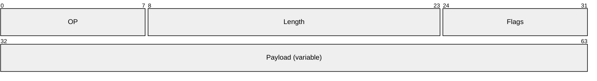

> [!example]- Source
> ```text
> ---
> config:
>   packet:
>     rowHeight: 48
> ---
> packet-beta
>     0-7: "OP"
>     8-23: "Length"
>     24-31: "Flags"
>     32-63: "Payload (variable)"
> ```

## 20. Kanban

*columns and cards, ticket / assignee / priority* · [syntax](https://mermaid.ai/open-source/syntax/kanban.html)

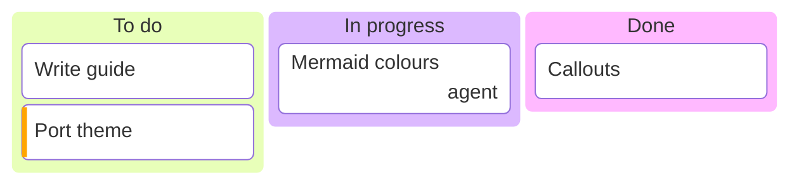

> [!example]- Source
> ```text
> kanban
>     todo[To do]
>         t1[Write guide]
>         t2[Port theme]@{ priority: 'High' }
>     doing[In progress]
>         t3[Mermaid colours]@{ assigned: 'agent' }
>     done[Done]
>         t4[Callouts]
> ```

## 21. Architecture

*groups, services, edges* · [syntax](https://mermaid.ai/open-source/syntax/architecture.html)

```mermaid
architecture-beta
    group cloud(cloud)[Cloud]
    service api(server)[API] in cloud
    service db(database)[DB] in cloud
    service disk(disk)[Storage] in cloud
    service web(internet)[Web]
    web:R --> L:api
    api:R -- L:db
    db:B -- T:disk
```

> [!example]- Source
> ```text
> architecture-beta
>     group cloud(cloud)[Cloud]
>     service api(server)[API] in cloud
>     service db(database)[DB] in cloud
>     service disk(disk)[Storage] in cloud
>     service web(internet)[Web]
>     web:R --> L:api
>     api:R -- L:db
>     db:B -- T:disk
> ```

## 22. Radar

*axes, two curves, legend* · [syntax](https://mermaid.ai/open-source/syntax/radar.html)

```mermaid
radar-beta
    title Skills
    axis a["Speed"], b["Safety"], c["Docs"], d["Tests"], e["UX"]
    curve now["Now"]{3, 4, 2, 3, 2}
    curve goal["Goal"]{4, 5, 4, 4, 4}
    max 5
```

> [!example]- Source
> ```text
> radar-beta
>     title Skills
>     axis a["Speed"], b["Safety"], c["Docs"], d["Tests"], e["UX"]
>     curve now["Now"]{3, 4, 2, 3, 2}
>     curve goal["Goal"]{4, 5, 4, 4, 4}
>     max 5
> ```

## 23. Treemap

*nested sections and leaf values* · [syntax](https://mermaid.ai/open-source/syntax/treemap.html)

```mermaid
treemap-beta
"Project"
    "Firmware"
        "Crypto": 30
        "Boot": 10
    "App"
        "UI": 25
        "Network": 15
    "Docs": 8
```

> [!example]- Source
> ```text
> treemap-beta
> "Project"
>     "Firmware"
>         "Crypto": 30
>         "Boot": 10
>     "App"
>         "UI": 25
>         "Network": 15
>     "Docs": 8
> ```

## 24. Dense flowchart, default layout

*the same graph as the next sample, laid out by the default dagre engine* · [syntax](https://mermaid.ai/open-source/syntax/flowchart.html)

```mermaid
flowchart LR
    subgraph DEV [Device]
        FW[Firmware] --> SEC[(Secure store)]
        FW --> LOG[Log]
    end
    subgraph APP [App]
        UI[Screen] --> SVC[Service]
        SVC --> CACHE[(Cache)]
    end
    subgraph SRV [Server]
        API[API] --> DB[(Database)]
        API --> Q[Queue]
        Q --> W[Worker]
    end
    SVC --> FW
    SVC --> API
    W --> DB
    LOG --> API
    W -.-> SVC
    UI --> LOG
```

> [!example]- Source
> ```text
> flowchart LR
>     subgraph DEV [Device]
>         FW[Firmware] --> SEC[(Secure store)]
>         FW --> LOG[Log]
>     end
>     subgraph APP [App]
>         UI[Screen] --> SVC[Service]
>         SVC --> CACHE[(Cache)]
>     end
>     subgraph SRV [Server]
>         API[API] --> DB[(Database)]
>         API --> Q[Queue]
>         Q --> W[Worker]
>     end
>     SVC --> FW
>     SVC --> API
>     W --> DB
>     LOG --> API
>     W -.-> SVC
>     UI --> LOG
> ```

## 25. Dense flowchart, ELK layout

*first line %% elk %% (Mermaid ELK Renderer): fewer crossings, straighter edges, tidier subgraphs* · [syntax](https://mermaid.ai/open-source/syntax/flowchart.html)

```mermaid
%% elk %%
flowchart LR
    subgraph DEV [Device]
        FW[Firmware] --> SEC[(Secure store)]
        FW --> LOG[Log]
    end
    subgraph APP [App]
        UI[Screen] --> SVC[Service]
        SVC --> CACHE[(Cache)]
    end
    subgraph SRV [Server]
        API[API] --> DB[(Database)]
        API --> Q[Queue]
        Q --> W[Worker]
    end
    SVC --> FW
    SVC --> API
    W --> DB
    LOG --> API
    W -.-> SVC
    UI --> LOG
```

> [!example]- Source
> ```text
> %% elk %%
> flowchart LR
>     subgraph DEV [Device]
>         FW[Firmware] --> SEC[(Secure store)]
>         FW --> LOG[Log]
>     end
>     subgraph APP [App]
>         UI[Screen] --> SVC[Service]
>         SVC --> CACHE[(Cache)]
>     end
>     subgraph SRV [Server]
>         API[API] --> DB[(Database)]
>         API --> Q[Queue]
>         Q --> W[Worker]
>     end
>     SVC --> FW
>     SVC --> API
>     W --> DB
>     LOG --> API
>     W -.-> SVC
>     UI --> LOG
> ```

## 26. State, ELK layout

*state machine with %% elk %%* · [syntax](https://mermaid.ai/open-source/syntax/stateDiagram.html)

```mermaid
%% elk %%
stateDiagram-v2
    [*] --> Offline
    Offline --> Connecting : CONNECT
    Connecting --> Online : ok
    Connecting --> Offline : refused
    Online --> Reconnecting : RECONNECT
    Reconnecting --> Online : ok
    Online --> Offline : DISCONNECT
    Online --> Loading : SYNC
    Loading --> Online : done
    Loading --> Online : error
```

> [!example]- Source
> ```text
> %% elk %%
> stateDiagram-v2
>     [*] --> Offline
>     Offline --> Connecting : CONNECT
>     Connecting --> Online : ok
>     Connecting --> Offline : refused
>     Online --> Reconnecting : RECONNECT
>     Reconnecting --> Online : ok
>     Online --> Offline : DISCONNECT
>     Online --> Loading : SYNC
>     Loading --> Online : done
>     Loading --> Online : error
> ```

## 27. Class, ELK layout

*class diagram with %% elk %%* · [syntax](https://mermaid.ai/open-source/syntax/classDiagram.html)

```mermaid
%% elk %%
classDiagram
    Vehicle <|-- Car
    Vehicle <|-- Truck
    Car *-- Engine
    Truck *-- Engine
    Car o-- Wheel
    Truck o-- Wheel
    Garage --> Car
    Garage --> Truck
```

> [!example]- Source
> ```text
> %% elk %%
> classDiagram
>     Vehicle <|-- Car
>     Vehicle <|-- Truck
>     Car *-- Engine
>     Truck *-- Engine
>     Car o-- Wheel
>     Truck o-- Wheel
>     Garage --> Car
>     Garage --> Truck
> ```

## 28. Ishikawa (fishbone)

*effect, cause categories, nested causes (11.12)* · [syntax](https://mermaid.ai/open-source/syntax/ishikawa.html)

```mermaid
ishikawa-beta
    Boot fails
    Firmware
        Wrong image
        Bad signature
    Hardware
        Flash
            Worn cells
            Bad wiring
        Power
    Process
        Skipped test
    Environment
        Too cold
```

> [!example]- Source
> ```text
> ishikawa-beta
>     Boot fails
>     Firmware
>         Wrong image
>         Bad signature
>     Hardware
>         Flash
>             Worn cells
>             Bad wiring
>         Power
>     Process
>         Skipped test
>     Environment
>         Too cold
> ```

## 29. Tree view

*folders, files, comments, highlight (11.14); vault status classes :::new / :::edited / :::ported / :::removed colour the name and its comment* · [syntax](https://mermaid.ai/open-source/syntax/treeView.html)

```mermaid
treeView-beta
    project/
        src/
            main.c :::highlight ## entry point
            crypto.c :::new ## added for key storage
            util.h :::edited ## buffer sizes
            port.c :::ported ## from the reference board
            legacy.c :::removed ## replaced by crypto.c
        docs/
            guide.md
        Makefile
```

> [!example]- Source
> ```text
> treeView-beta
>     project/
>         src/
>             main.c :::highlight ## entry point
>             crypto.c :::new ## added for key storage
>             util.h :::edited ## buffer sizes
>             port.c :::ported ## from the reference board
>             legacy.c :::removed ## replaced by crypto.c
>         docs/
>             guide.md
>         Makefile
> ```

## 30. Venn

*sets and a named overlap (11.12)* · [syntax](https://mermaid.ai/open-source/syntax/venn.html)

```mermaid
venn-beta
    title "Who touches the key"
    set Firmware
    set App
    set Server
    union Firmware,App["Load"]
    union App,Server["Transport"]
```

> [!example]- Source
> ```text
> venn-beta
>     title "Who touches the key"
>     set Firmware
>     set App
>     set Server
>     union Firmware,App["Load"]
>     union App,Server["Transport"]
> ```

## 31. Railroad

*grammar as a syntax diagram, EBNF (11.16)* · [syntax](https://mermaid.ai/open-source/syntax/railroad.html)

```mermaid
railroad-ebnf-beta
title "Frame"

frame = op , length , [ token ] ;
op = "0x10" | "0x11" | "0x12" ;
```

> [!example]- Source
> ```text
> railroad-ebnf-beta
> title "Frame"
> 
> frame = op , length , [ token ] ;
> op = "0x10" | "0x11" | "0x12" ;
> ```

## 32. Wardley map

*components on value chain vs evolution (11.14)* · [syntax](https://mermaid.ai/open-source/syntax/wardley.html)

```mermaid
wardley-beta
title Key service

component User [0.95, 0.70]
component App [0.80, 0.55]
component API [0.55, 0.60]
component Database [0.40, 0.80]

User -> App
App -> API
API -> Database

evolve API 0.80
```

> [!example]- Source
> ```text
> wardley-beta
> title Key service
> 
> component User [0.95, 0.70]
> component App [0.80, 0.55]
> component API [0.55, 0.60]
> component Database [0.40, 0.80]
> 
> User -> App
> App -> API
> API -> Database
> 
> evolve API 0.80
> ```

## 33. Event modeling

*time frames of UI, command, event (11.15)* · [syntax](https://mermaid.ai/open-source/syntax/eventmodeling.html)

```mermaid
eventmodeling

tf 01 ui CartUI
tf 02 cmd AddItem
tf 03 evt ItemAdded
```

> [!example]- Source
> ```text
> eventmodeling
> 
> tf 01 ui CartUI
> tf 02 cmd AddItem
> tf 03 evt ItemAdded
> ```

## 34. Cynefin

*the four domains (11.16)* · [syntax](https://mermaid.ai/open-source/syntax/cynefin.html)

```mermaid
cynefin-beta
  title Where is the problem
  complex
  complicated
  clear
  chaotic
```

> [!example]- Source
> ```text
> cynefin-beta
>   title Where is the problem
>   complex
>   complicated
>   clear
>   chaotic
> ```
